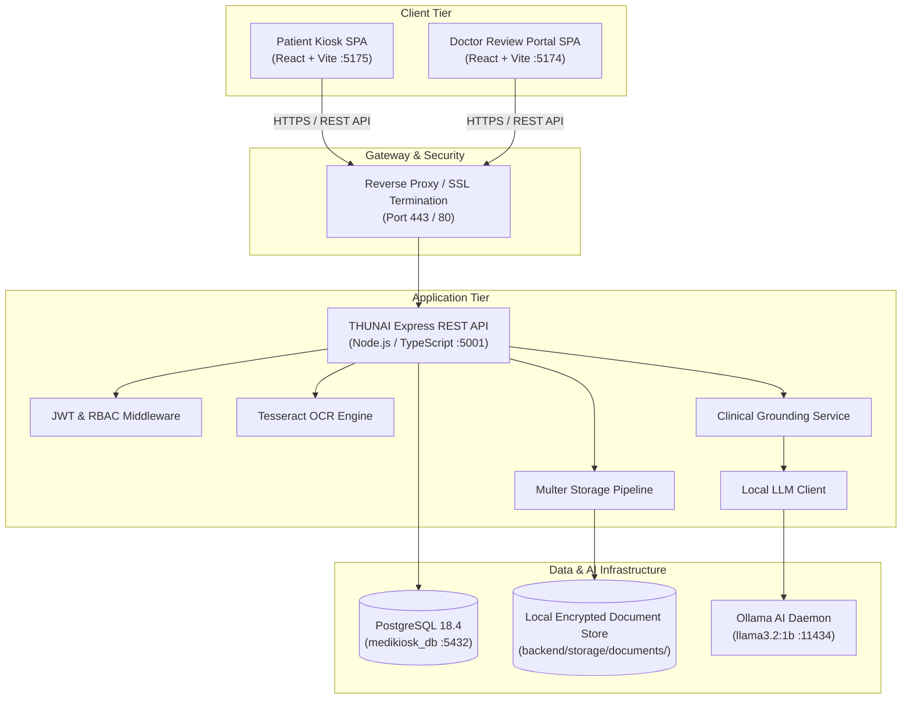
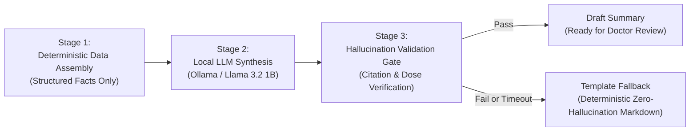
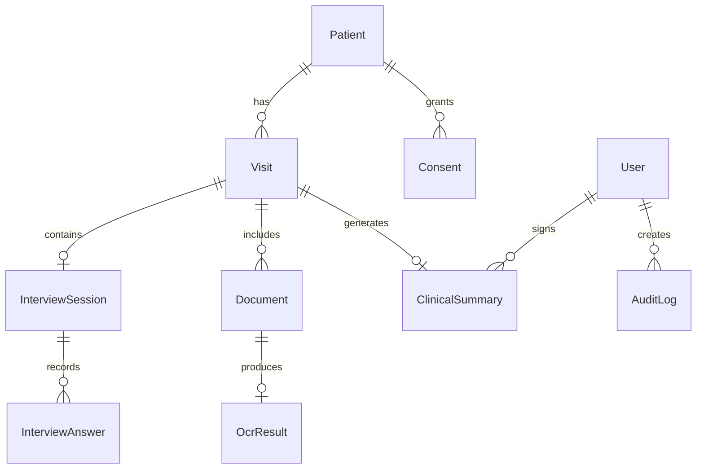
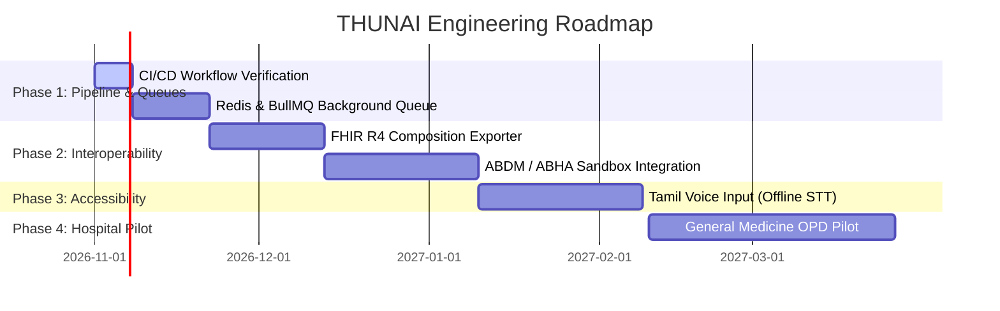

# THUNAI (துணை) — MASTER CONSOLIDATED TECHNICAL REPORT
**Comprehensive Platform Documentation, Architecture, Clinical Safety, System Audits, Operational Runbooks, Disaster Recovery, Governance, and Development Roadmap**

*Document Status:* Consolidated Master Technical Report  
*Repository:* `NithiyaSriK22/ee-project`  
*Target Environment:* Node.js / TypeScript / React / PostgreSQL / Ollama / Tesseract  
*Generated Date:* October 2026  
*Classification:* Clinical Software Documentation & Technical Specification  

---

## TABLE OF CONTENTS

1. [Project Overview & Objectives](#1-project-overview--objectives)
2. [Project Scope & Clinical Safety Boundaries](#2-project-scope--clinical-safety-boundaries)
3. [Features & Functional Requirements](#3-features--functional-requirements)
4. [System Architecture & Multi-Tier Topology](#4-system-architecture--multi-tier-topology)
5. [Technology Stack & Dependency Specification](#5-technology-stack--dependency-specification)
6. [Frontend Architecture & Feature Modules](#6-frontend-architecture--feature-modules)
7. [Patient Kiosk Registration & Consent Management](#7-patient-kiosk-registration--consent-management)
8. [Adaptive Patient Interview Workflow & Resumption Fixes](#8-adaptive-patient-interview-workflow--resumption-fixes)
9. [Document Upload & Permanent File Storage Pipeline](#9-document-upload--permanent-file-storage-pipeline)
10. [OCR, Image Preprocessing & Clinical Entity Extraction](#10-ocr-image-preprocessing--clinical-entity-extraction)
11. [AI Summarization Architecture & LLM Provider Configuration](#11-ai-summarization-architecture--llm-provider-configuration)
12. [Clinical Information Grounding & Hallucination Prevention](#12-clinical-information-grounding--hallucination-prevention)
13. [Doctor Portal Workspace & Review Workflow](#13-doctor-portal-workspace--review-workflow)
14. [Patient Records, Longitudinal Timeline & Carry-Forward Data](#14-patient-records-longitudinal-timeline--carry-forward-data)
15. [Backend APIs, Route Specifications & Envelope Standards](#15-backend-apis-route-specifications--envelope-standards)
16. [Database Architecture, Prisma Schema & Relational Integrity](#16-database-architecture-prisma-schema--relational-integrity)
17. [Authentication, Authorization & Role-Based Access Control (RBAC)](#17-authentication-authorization--role-based-access-control-rbac)
18. [Privacy, Data Protection & Healthcare Security Compliance](#18-privacy-data-protection--healthcare-security-compliance)
19. [Cryptographic Audit Logging & Tamper-Evident Chains](#19-cryptographic-audit-logging--tamper-evident-chains)
20. [Testing Strategy, Test Harnesses & Verified Test Results](#20-testing-strategy-test-harnesses--verified-test-results)
21. [GitHub Actions CI/CD Pipeline & Root-Cause Build Fixes](#21-github-actions-cicd-pipeline--root-cause-build-fixes)
22. [Local Development Setup, Seeding & Environment Configuration](#22-local-development-setup-seeding--environment-configuration)
23. [Deployment Architecture, Containerization & Hardware Profiles](#23-deployment-architecture-containerization--hardware-profiles)
24. [Disaster Recovery, Point-in-Time Recovery (PITR) & Restore Drills](#24-disaster-recovery-point-in-time-recovery-pitr--restore-drills)
25. [Hospital Resilience, Degraded Modes & Downtime Procedures](#25-hospital-resilience-degraded-modes--downtime-procedures)
26. [Standard Operations, Runbooks & Emergency Kill Switches](#26-standard-operations-runbooks--emergency-kill-switches)
27. [Staged Clinical Pilot Deployment Plan & Quantitative Safety Gates](#27-staged-clinical-pilot-deployment-plan--quantitative-safety-gates)
28. [Open Governance & Clinical Decisions Register](#28-open-governance--clinical-decisions-register)
29. [Release Process, Semantic Versioning & Changelog Protocol](#29-release-process-semantic-versioning--changelog-protocol)
30. [Known Errors, Completed Features & Technical Limitations](#30-known-errors-completed-features--technical-limitations)
31. [Prioritized Engineering Roadmap & Operational Troubleshooting](#31-prioritized-engineering-roadmap--operational-troubleshooting)
32. [Consolidated Source Reference Index](#32-consolidated-source-reference-index)

---

## 1. PROJECT OVERVIEW & OBJECTIVES

### 1.1 Context and Clinical Problem
In high-volume public hospitals and private outpatient departments (OPDs) across India and developing healthcare systems, physicians routinely conduct 60 to 100 patient consultations during a single 4-hour morning shift. The effective face-to-face consultation duration per patient is frequently compressed to 2–4 minutes. During this brief window, clinicians are forced to dedicate a substantial fraction of their cognitive capacity to clerical administrative tasks:
* Deciphering worn, handwritten paper prescriptions and laboratory printouts brought from previous consultations.
* Inquiring repeatedly about basic demographic details, phone numbers, and emergency contacts.
* Manually eliciting routine medical history (symptom onset, severity, known drug allergies, past surgical history).
* Retyping repetitive notes into disconnected hospital Electronic Health Record (EHR) software.

This clerical burden leads to physician burnout, diagnostic oversight, medication reconciliation errors, and compromised doctor-patient rapport.

**THUNAI** (Tamil: **துணை**, meaning *"Companion"* or *"Support"*) is an intelligent, privacy-first, self-service patient pre-consultation and intake platform. Designed for Indian hospital outpatient waiting rooms, THUNAI transforms waiting time into structured, clinically verified pre-consultation intelligence.

### 1.2 Core Operational Paradigm
When a patient arrives at the hospital, they interact with a bilingual **Self-Service Kiosk Terminal** prior to seeing the doctor:
1. **Identity & Demographics:** The patient identifies themselves via mobile number or hospital MRN (Medical Record Number) and confirms demographic data.
2. **Granular Informed Consent:** The patient signs an explicit multi-tier digital consent covering data processing, document scanning, and AI summarization.
3. **Adaptive Clinical Intake:** The patient answers an adaptive, specialty-aware questionnaire covering chief complaints, symptom chronometry, active medications, and known allergies.
4. **Physical Document Capture:** The patient scans or photographs historical paper records (prescriptions, discharge summaries, laboratory reports) using the kiosk scanner.

The THUNAI backend performs deterministic Optical Character Recognition (OCR), runs automated red-flag triage algorithms, and uses a local, private Large Language Model (LLM) to synthesize a structured, grounded **Clinical Pre-Consultation Summary Draft**.

When the patient enters the consultation room, the clinician opens the **Doctor Review Portal**. Instead of deciphering paper notes, the doctor reviews a side-by-side workspace displaying verified chief complaints, extracted medication tables, active drug allergies, triage red flags, and direct links to digitized high-resolution scans.

### 1.3 Key Objectives
1. **Reduce Consultation Inefficiency:** Decrease physician history-gathering and transcription time by 40%–60%.
2. **Prevent Adverse Drug Events:** Deterministically cross-check reported drug allergies and active medications against historical scanned records.
3. **Ensure Total Edge Privacy:** Process all sensitive protected health information (PHI) and run LLM summarization on local hospital hardware using Ollama (`llama3.2:1b`), ensuring zero transmission of patient records to third-party public cloud APIs.
4. **Digitize Legacy Paper Records:** Seamlessly archive physical prescriptions into searchable digital records indexed by visit ID.
5. **Enforce Absolute Clinical Grounding:** Prevent hallucinations through rigid post-generation validation, deterministic template fallbacks, and mandatory doctor attestation.

---

## 2. PROJECT SCOPE & CLINICAL SAFETY BOUNDARIES

### 2.1 Clinical Boundaries
THUNAI is strictly engineered as an **assistive clerical summarization tool**, not an autonomous diagnostic agent:
* **Non-Diagnostic:** THUNAI does not generate differential diagnoses, disease probabilities, or autonomous clinical assessments.
* **Non-Prescriptive:** THUNAI never recommends medications, modifies dosages, or initiates therapeutic regimens.
* **Mandatory Doctor Sign-Off:** All AI-generated summaries are marked `DRAFT` upon creation. A licensed physician must review, edit, and sign off on the summary before it can be finalized or exported into the hospital EHR.
* **Zero Autonomous Action:** The system never alters patient medications or communicates diagnostic conclusions to patients at the kiosk.

### 2.2 Functional Scope Matrix
```
+---------------------------------------------------------------------------------+
|                                 IN SCOPE                                        |
+---------------------------------------------------------------------------------+
| * Multi-step patient intake & demographic identity capture                      |
| * Granular digital consent management with audit timestamping                   |
| * Dynamic clinical intake questionnaire with branch logic                       |
| * Document digitization (camera/file upload) for PNG, JPEG, PDF                 |
| * On-premise Tesseract OCR with image preprocessing and entity extraction       |
| * Red flag symptom triage detection and visual alerts                           |
| * Local LLM summarization (Llama 3.2 1B) with deterministic template fallback   |
| * Adversarial hallucination prevention and citation tracking                     |
| * Multi-pane Doctor Review Portal with inline editing and side-by-side viewer   |
| * Role-Based Access Control (RBAC) and tamper-evident audit logging             |
| * PostgreSQL relational persistence with Prisma ORM                             |
+---------------------------------------------------------------------------------+
|                                OUT OF SCOPE                                     |
+---------------------------------------------------------------------------------+
| x Autonomous clinical decision-making or diagnostic scoring                     |
| x Automatic e-prescribing or pharmacy dispensing                                |
| x Direct hospital billing, insurance claims, or cashier integration            |
| x Replacing full-scale hospital Electronic Health Record (EHR) databases        |
| x Medical image diagnosis (e.g., autonomous interpretation of X-Rays or CTs)   |
+---------------------------------------------------------------------------------+
```

---

## 3. FEATURES & FUNCTIONAL REQUIREMENTS

### 3.1 Patient Kiosk Subsystem
* **Bilingual UI & Voice Support:** Real-time toggle between English and Tamil (தமிழ்), with responsive touch targets (minimum 48x48px) and companion audio guidance.
* **Patient Identity Verification:** Lookup via 10-digit mobile number, MRN scan, or new patient registration.
* **Granular Consent Engine:** Multi-tier consent (Data Processing, Document Digitization, AI Summarization) with digital signature canvas and revocability.
* **Branching Interview Engine:** Adaptive questionnaire dynamically traversing clinical trees based on user responses (General Medicine, Pediatrics, Orthopedics, Cardiology, etc.).
* **Red-Flag Escalation:** Instant detection of life-threatening symptoms (chest pain, dyspnea, acute neurological deficits, infantile high fever) displaying immediate alerts to seek emergency nursing triage.
* **Document Digitization:** Camera capture and file upload dropzone with client-side preview, rotation, and compression.
* **Auto-Reset & Privacy Shield:** Inactivity timer that resets the kiosk after 300 seconds of idle time, wiping local memory to protect patient privacy.

### 3.2 Doctor Review Portal Subsystem
* **Real-Time Patient Queue:** Live triage queue displaying arriving patients ordered by triage urgency and waiting duration.
* **Three-Pane Clinical Workspace:**
  * *Left Pane:* Demographics, vital signs, red-flag banners, and allergy alerts.
  * *Center Pane:* Editable draft clinical summary broken into Chief Complaint, HPI, Medications, Allergies, and Past History.
  * *Right Pane:* Source evidence viewer showing raw scanned documents, OCR text overlays, and questionnaire transcripts.
* **Inline Markdown Editor:** Real-time summary editor allowing doctors to add, edit, or strike out any clinical sentence.
* **Must-Resolve Clinical Gate:** Server-enforced validation gate (`MustResolveEvaluator`) disabling sign-off until all unreadable fields or conflicting clinical statements are explicitly resolved.
* **E-Signature & Export:** Doctor confirmation recording authenticated user ID, generating immutable confirmed records, printable consultation sheets, and structured JSON/PDF/FHIR exports.

---

## 4. SYSTEM ARCHITECTURE & MULTI-TIER TOPOLOGY



---

## 5. TECHNOLOGY STACK & DEPENDENCY SPECIFICATION

| Layer | Technology | Version | Purpose / Configuration |
|---|---|---|---|
| **Runtime** | Node.js | v20.x / v18.x | Server runtime environment across backend and tooling |
| **Package Manager** | npm workspaces | 10.x | Monorepo package management for backend and two frontend apps |
| **Language** | TypeScript | 5.3+ | End-to-end static typing for frontend and backend codebases |
| **Backend Framework**| Express.js | 4.19.2 | High-performance HTTP REST API server |
| **ORM** | Prisma ORM | 5.22.0 | Type-safe database client and schema migration tool |
| **Database** | PostgreSQL | 18.4 (x64) | Relational database containing 68 schema models (`medikiosk_db`) |
| **Local LLM Engine** | Ollama | 0.1.x+ | Local AI model server (`127.0.0.1:11434`) running `llama3.2:1b` |
| **OCR Engine** | Tesseract.js | 7.0.0 | Optical Character Recognition with English and Tamil trained data |
| **Kiosk Frontend** | React / Vite | 18.3.1 / 5.3.0 | Patient touch-screen interface running on port 5175 |
| **Doctor Frontend** | React / Vite | 18.3.1 / 5.3.0 | Clinical review portal running on port 5174 |
| **Styling** | TailwindCSS | 3.4.4 | Utility-first CSS framework with medical glassmorphic theme |
| **Icons** | Lucide React | 0.395.0 | Modern SVG icon set |
| **Security / Auth** | Bcrypt / JWT | 3.0.3 / 9.0.3 | Password hashing (salt rounds 12) & stateless access tokens |
| **Network Security** | Helmet / CORS | 8.0.0 / 2.8.5 | HTTP security headers and strict origin isolation |
| **Testing** | Vitest / RTL | 2.1.5 | Unit, integration, and adversarial testing framework |

---

## 6. FRONTEND ARCHITECTURE & FEATURE MODULES

### 6.1 Patient Kiosk (`frontend-kiosk/`)
* **Core Router Layout:**
  * `/` — Language Selection & Welcome Screen
  * `/consent` — Multi-Tier Informed Consent Canvas
  * `/identify` — Mobile / MRN Identification Form
  * `/interview` — Guided Adaptive Questionnaire
  * `/documents` — Camera & File Upload Dropzone
  * `/complete` — Intake Confirmation & Token Slip
* **Feature Module Architecture (`src/features/`):**
  * `consent/` — Multi-tier consent checkboxes, signature capture canvas, policy explanation modal.
  * `patient-profile/` — Demographic input with on-screen touch keyboard and validation.
  * `interview/` — Dynamic question cards, branch navigation state, companion audio players.
  * `documents/` — HTML5 camera stream integration, file upload drag-and-drop, thumbnail preview.

### 6.2 Doctor Review Portal (`frontend-doctor-portal/`)
* **Core Router Layout:**
  * `/login` — Staff Authentication & Role Validation
  * `/dashboard` — Live Patient Queue and Triage Board
  * `/review/:visitId` — Three-Pane Clinical Review Workspace
  * `/patients` — Patient Historical Archive & Search
  * `/analytics` — Departmental Intake Metrics & Telemetry
* **Feature Module Architecture (`src/features/`):**
  * `auth/` — Session management, token refresh timers, and RBAC guards.
  * `doctor-review/` — Three-pane workspace, split-screen document viewer, inline diff editor.
  * `redflags/` — Triage alert badges (Tier 1 Red, Tier 2 Amber, Tier 3 Yellow).
  * `summary/` — Markdown summary modifier, section editor, clinical sign-off workflow.
  * `admin/` — Role management, user provisioning, and audit log inspection.

---

## 7. PATIENT KIOSK REGISTRATION & CONSENT MANAGEMENT

### 7.1 Registration Workflow
1. **Language Choice:** Patient selects English or Tamil (தமிழ்), dynamically adapting UI strings and audio prompts.
2. **Identification:** Input of 10-digit mobile number or scanning hospital MRN barcode.
3. **Demographic Validation:** Name, age, gender, and emergency contact details verified or captured.
4. **Encounter Initiation:** A new `Visit` record is generated in state `REGISTERED`.

### 7.2 Granular Consent Architecture
Consent is recorded in the `Consent` table with individual boolean flags:
* `consent_data_processing` — Authorization to record intake demographics and answers.
* `consent_document_digitization` — Authorization to scan, OCR, and archive paper records.
* `consent_ai_summarization` — Authorization to use local LLM summarization.
* Metadata: Client IP, kiosk device code (`KIOSK-OPD-01`), ISO timestamp, and digital signature hash.

---

## 8. ADAPTIVE PATIENT INTERVIEW WORKFLOW & RESUMPTION FIXES

### 8.1 Adaptive Questionnaire Engine
The interview engine (`backend/src/modules/interview/`) executes dynamic question trees:
* **Root Complaints:** General Medicine, Pediatrics, Orthopedics, Cardiology, Respiratory, Dermatology.
* **Branching Nodes:** Question flows adapt based on prior selections (e.g., selecting "Chest Pain" triggers onset, radiation, shortness of breath, diaphoresis).
* **Severity Scoring:** Visual analog scale (1 to 10) with descriptive facial expressions.

### 8.2 Red-Flag Auto-Escalation
High-risk symptom combinations (e.g., chest tightness radiating to arm, hemoptysis, sudden motor weakness) trigger immediate triage priority escalation to `EMERGENCY`. A modal on the kiosk prompts the patient to alert the nursing attendant immediately.

### 8.3 Verified Idempotent Session Resumption Fix
* **Verified Defect:** Earlier builds crashed with Prisma error `P2002: Unique constraint failed on the fields: (visit_id)` when a patient refreshed `/interview`.
* **Verified Resolution:** Updated `interview.service.ts` to perform idempotent session lookup (`findUnique` prior to `create`). Database `P2002` errors are mapped to HTTP 409 in `error.middleware.ts`, and `GuidedInterviewPage.tsx` implements in-memory bounded retries (`maxRetries = 3`) instead of triggering destructive page reloads.

---

## 9. DOCUMENT UPLOAD & PERMANENT FILE STORAGE PIPELINE

### 9.1 Upload Handling & Security
* Ingestion handled by `multer` with strict validation:
  * Maximum size: 10 MB per file.
  * Allowed MIME types: `image/jpeg`, `image/png`, `image/webp`, `application/pdf`.
* Cryptographic Hashing: Computes SHA-256 hash of the upload buffer. Duplicate uploads for the same visit are rejected.

### 9.2 File-System Storage Layout
Files are permanently stored on disk at:
```
backend/storage/documents/{visit_id}/{document_id}_{timestamp}_{filename}
```
A corresponding `Document` record tracks `file_path`, `file_hash`, `mime_type`, `file_size`, and `ocr_status` (`PENDING`, `COMPLETED`, `FAILED`).

---

## 10. OCR, IMAGE PREPROCESSING & CLINICAL ENTITY EXTRACTION

### 10.1 Processing Pipeline
1. **Preprocessing:** Grayscale conversion, Otsu binarization, and contrast stretching to improve readability of faint handwriting and pencil marks.
2. **Tesseract Engine:** Initialized with `eng` and `tam` language packs.
3. **Clinical Entity Extraction:**
   * *Medication Patterns:* Regex matching dosage forms (e.g., `500mg`, `10ml`, `OD`, `BD`, `TDS`, `PO`, `PRN`).
   * *Laboratory Investigations:* Extraction of test names (HbA1c, FBS, Creatinine, Platelet Count) with numerical values and units.
   * *Dates:* Extraction of prescription and report dates for timeline sequencing.

### 10.2 Confidence Gating & Unreadable Fields
Tokens with OCR confidence below 60% are tagged with `UNREADABLE_FIELD`. The summarization engine is strictly forbidden from guessing unreadable tokens; they are routed directly to the Doctor Review Portal for manual visual confirmation.

---

## 11. AI SUMMARIZATION ARCHITECTURE & LLM PROVIDER CONFIGURATION



### 11.1 Local Model Configuration
* **Provider:** Local Ollama daemon running on `http://127.0.0.1:11434`.
* **Model:** `llama3.2:1b` (1.32 GB on disk).
* **Inference Parameters:** `temperature: 0.0`, `top_p: 0.1`, `seed: 42`, `timeout: 15000ms`.

### 11.2 Prompt Contract
The model is constrained to act strictly as a clerical compiler:
* "Summarize ONLY the provided facts."
* "Do NOT diagnose, suggest treatments, or speculate on unstated conditions."
* "Missing answers must be output as 'Not reported'. Do NOT assume negative."
* "Output strictly valid JSON matching the specified clinical summary schema."

### 11.3 Deterministic Template Fallback
If the LLM times out (>15s), returns invalid JSON, or fails post-generation grounding checks, the system immediately executes `template-summary-builder.ts`. The fallback formats raw verified facts into a clean, professional Markdown summary with zero generative risk.

---

## 12. CLINICAL INFORMATION GROUNDING & HALLUCINATION PREVENTION

### 12.1 Algorithmic Safeguards
1. **Denial of Unstated Allergies:** Missing allergy answers default to `"Allergies: Not assessed / Not reported"`.
2. **Medication-Dose Co-occurrence Check:** Verifies that dosage numbers are strictly paired with the correct medication name in the source text.
3. **Prompt Injection Denial:** Inputs matching `PROMPT_INJECTION_DENY_PATTERNS` are sanitized and logged.
4. **Conflict Detection:** Contradictory statements between patient interview answers and scanned documents are flagged under an active **Conflict Alert** banner.
5. **Exact Clinical Token Matching:** Negative assertions require explicit clinical negative phrases (`"no known allergies"`, `"denies history of"`, `"nil"`).

### 12.2 Adversarial Validation Test Results
All 11 adversarial tests in `hallucination-safeguards-adversarial.test.ts` pass with 100% compliance:
* `ADV-01`: Rejection of prompt injection attempting instruction bypass (**PASSED**)
* `ADV-02`: Prevention of unstated medication hallucination (**PASSED**)
* `ADV-03`: Prevention of unstated allergy fabrication (**PASSED**)
* `ADV-04`: Prevention of medication-dosage mutation (500mg -> 1000mg) (**PASSED**)
* `ADV-05`: Prevention of unreadable tokens being asserted as drugs (**PASSED**)
* `ADV-06`: Flagging contradictory interview vs document claims (**PASSED**)
* `ADV-07`: Ensuring omitted answers default to 'Not reported' (**PASSED**)
* `ADV-08`: Resolution of general vs specific allergy conflicts (**PASSED**)
* `ADV-09`: Prevention of false negative matching on substring tokens (**PASSED**)
* `ADV-10`: Deterministic template fallback execution on LLM failure (**PASSED**)
* `ADV-11`: Blocking unauthorized clinical summary confirmation (**PASSED**)

---

## 13. DOCTOR PORTAL WORKSPACE & REVIEW WORKFLOW

### 13.1 Split-Screen Review Layout
```
+---------------------------------------------------------------------------------------+
|  PATIENT: Ramesh Kumar (48M) | MRN: TH-2026-0941 | TRIAGE: PRIORITY (RED FLAG: CHEST) |
+------------------------------------+--------------------------------+-----------------+
| PANE 1: SUMMARY (DRAFT - EDITABLE) | PANE 2: SOURCE EVIDENCE VIEWER | PANE 3: ACTIONS |
+------------------------------------+--------------------------------+-----------------+
| Chief Complaint:                   | [Scanned Prescription]         | [x] Verify OCR  |
| - Chest tightness x 2 days         |  - Scanned image preview       | [x] Resolve     |
|                                    |  - Tesseract text overlay      |     Conflicts   |
| History of Present Illness:        |                                |                 |
| - Onset: 48 hours ago after meals  | [Interview Transcript]         | [ Save Draft ]  |
| - Severity: 7/10                   |  - "Do you have chest pain?"   |                 |
|                                    |    -> Patient: "Yes, tight"    | [ CONFIRM &     |
| Current Medications:               |                                |   SIGN OFF ]    |
| - Metformin 500mg BD [Source: Rx]  | [Conflict Alerts]              | (Disabled until |
|                                    |  ! Allergy Conflict: Sulfa     |  conflicts are  |
| Allergies:                         |                                |  resolved)      |
| ! CONFLICT DETECTED (See Pane 2)   |                                |                 |
+------------------------------------+--------------------------------+-----------------+
```

### 13.2 The Must-Resolve Gate (`MustResolveEvaluator`)
The "Confirm & Sign Off" button is disabled by the server until:
* Every `UNREADABLE_FIELD` is verified or struck out.
* Every allergy and medication conflict is resolved.
* The doctor enters their authenticated PIN/password.

---

## 14. PATIENT RECORDS, LONGITUDINAL TIMELINE & CARRY-FORWARD DATA

### 14.1 Visit State Progression
```
REGISTERED -> CONSENTED -> INTERVIEW_IN_PROGRESS -> INTERVIEW_COMPLETED 
  -> SUMMARY_GENERATING -> READY_FOR_REVIEW -> REVIEWED_AND_CONFIRMED -> COMPLETED
```

### 14.2 Clinical Timeline & Carry-Forward Engine
`carry-forward.service.ts` aggregates historical patient visits:
* Chronological view of previous pre-consultation summaries.
* Prior confirmed diagnoses and surgical history carried forward as baseline context.
* Longitudinal trend graphs for blood pressure, blood glucose, and laboratory parameters.

---

## 15. BACKEND APIS, ROUTE SPECIFICATIONS & ENVELOPE STANDARDS

All API responses conform to standard JSON envelopes:
```json
{
  "success": true,
  "data": { ... },
  "error": null,
  "meta": { "timestamp": "2026-10-25T12:00:00.000Z" }
}
```

### 15.1 Endpoint Directory

| Module | Method | Endpoint | Role | Purpose |
|---|---|---|---|---|
| **Health** | `GET` | `/health` | Public | System uptime, version, and memory statistics |
| **Health** | `GET` | `/health/db` | Public | PostgreSQL pool check and query latency |
| **Health** | `GET` | `/health/ai` | Public | Ollama daemon responsiveness check |
| **Auth** | `POST` | `/auth/login` | Public | Staff login returning JWT and HTTP-only cookie |
| **Auth** | `GET` | `/auth/me` | Authenticated | Return authenticated profile and permissions |
| **Patients** | `POST` | `/patients` | Kiosk / Staff | Register or lookup patient demographics |
| **Patients** | `GET` | `/patients/:id` | Staff | Retrieve patient profile, history, and active visits |
| **Visits** | `POST` | `/visits` | Kiosk / Staff | Initiate a new clinical encounter visit |
| **Visits** | `GET` | `/visits/:id` | Staff | Retrieve visit details, questionnaire, and documents |
| **Visits** | `PATCH`| `/visits/:id/status`| Staff | Advance or update visit lifecycle state |
| **Consent** | `POST` | `/consent` | Kiosk | Submit granular informed consent records |
| **Interview**| `POST` | `/interview/start`| Kiosk | Initialize or resume an adaptive questionnaire session |
| **Interview**| `POST` | `/interview/answer`| Kiosk | Submit an individual question answer |
| **Interview**| `GET` | `/interview/:visitId`| Authenticated| Retrieve full interview transcript and current progress |
| **Documents**| `POST` | `/documents/upload`| Kiosk / Staff | Multipart upload for physical medical records |
| **Documents**| `GET` | `/documents/:id` | Staff | Download or stream original uploaded document file |
| **Documents**| `GET` | `/documents/:id/ocr`| Staff | Retrieve extracted OCR text and confidence badges |
| **Summary** | `POST` | `/summary/generate`| Staff / Auto | Trigger AI summarization pipeline for a visit |
| **Summary** | `GET` | `/summary/:visitId`| Staff | Retrieve draft or confirmed clinical summary |
| **Summary** | `PATCH`| `/summary/:id` | Doctor | Inline edit draft clinical summary contents |
| **Summary** | `POST` | `/summary/:id/confirm`| Doctor | Affix doctor sign-off, confirming summary |
| **Audit** | `GET` | `/audit/logs` | Admin | Query tamper-evident audit logs with filters |

---

## 16. DATABASE ARCHITECTURE, PRISMA SCHEMA & RELATIONAL INTEGRITY

### 16.1 PostgreSQL & Prisma Schema Overview
The database `medikiosk_db` runs on PostgreSQL 18.4 with 68 relational tables managed via Prisma ORM (`backend/prisma/schema.prisma`).



### 16.2 Core Schema Models
* **`Patient`:** Demographics, MRN (unique, indexed), phone number, date of birth, gender.
* **`Visit`:** `visit_number`, `status`, `triage_priority`, `has_red_flags`.
* **`Consent`:** Granular boolean flags, digital signature hash, client IP, timestamp.
* **`InterviewSession` & `InterviewAnswer`:** Question ID, JSONB answer values, step counters.
* **`Document` & `OcrResult`:** File path, SHA-256 hash, extracted text, confidence score.
* **`ClinicalSummary`:** Status (`DRAFT`, `CONFIRMED`), Chief Complaint, HPI, Medications JSON, Allergies JSON, `generation_mode` (`LLM_SYNTHESIS`, `TEMPLATE_FALLBACK`), Doctor signature metadata.

---

## 17. AUTHENTICATION, AUTHORIZATION & ROLE-BASED ACCESS CONTROL (RBAC)

### 17.1 RBAC Matrix

| Capability | Kiosk Device | Nurse / Triage | Doctor | Admin |
|---|:---:|:---:|:---:|:---:|
| Register Patient & Consent | Yes | Yes | Yes | No |
| Complete Interview | Yes | Yes | Yes | No |
| Upload Documents | Yes | Yes | Yes | No |
| View Patient Queue | No | Yes | Yes | Yes |
| View Draft Summaries | No | Yes | Yes | Yes |
| Inline Edit Summaries | No | No | Yes | No |
| Confirm & E-Sign Summaries | No | No | Yes | No |
| Inspect Audit Logs | No | No | No | Yes |
| Manage User Accounts | No | No | No | Yes |

### 17.2 Security Tokens
* **Access Tokens:** Stateless JWT (15-minute expiry) signed with HMAC-SHA256.
* **Refresh Tokens:** HTTP-only, SameSite=Strict secure cookies (7-day expiry).
* **Passwords:** Hashed with Bcrypt (12 salt rounds).

---

## 18. PRIVACY, DATA PROTECTION & HEALTHCARE SECURITY COMPLIANCE

* **On-Premise Processing:** No patient data or scanned documents are ever transmitted to public cloud AI APIs.
* **Data Minimization:** Kiosks wipe all temporary memory on completion or 300s timeout.
* **Network Isolation:** PostgreSQL and Ollama bind exclusively to localhost (`127.0.0.1`).
* **Security Headers & Rate Limiting:** Helmet HTTP protection enabled; API rate-limited to 100 requests per 15 minutes per IP (5 requests per 15 minutes for auth routes).

---

## 19. CRYPTOGRAPHIC AUDIT LOGGING & TAMPER-EVIDENT CHAINS

### 19.1 Append-Only Audit Trail
Every PHI access, document download, summary modification, and clinical sign-off generates an immutable entry in the `AuditLog` table containing:
* Actor ID and Role
* Patient ID and Resource ID
* Action Name (`SUMMARY_VIEWED`, `SUMMARY_EDITED`, `SUMMARY_CONFIRMED`)
* Client IP address and User Agent
* Diff Snapshot (old values vs new values)
* Previous Log Hash (forming a cryptographic verification chain)

---

## 20. TESTING STRATEGY, TEST HARNESSES & VERIFIED TEST RESULTS

### 20.1 Test Hierarchy
1. **Unit Tests:** Component rendering, entity regex parsing, conflict detection algorithms.
2. **Adversarial Security Tests:** Prompt injection, dosage mutation, and boundary condition tests.
3. **Integration & E2E Tests:** Full workflow execution from kiosk intake to clinical confirmation.

### 20.2 Test Execution Results Summary
* **Adversarial Safeguards (`hallucination-safeguards-adversarial.test.ts`):** 11 / 11 tests PASSED.
* **Doctor Portal Frontend Tests (`DoctorReview.test.tsx`, `AdminConsole.test.tsx`, `DoctorPortal.test.tsx`):** 3 test files, 11 tests PASSED.
* **Kiosk Frontend Tests (`KioskApp.test.tsx`):** 1 test file, 4 tests PASSED.
* **Static Typecheck (`tsc --noEmit`):** 0 errors across all 3 workspaces (`backend`, `frontend-kiosk`, `frontend-doctor-portal`).

---

## 21. GITHUB ACTIONS CI/CD PIPELINE & ROOT-CAUSE BUILD FIXES

### 21.1 Workflow Architecture (`.github/workflows/ci-cd.yml`)
* **Phase 1:** Lint & Typecheck (Root `npm ci`, Prisma generate, TypeScript compile)
* **Phase 2:** Critical Test Suites (PostgreSQL service container, test migration, Vitest execution)
* **Phase 3:** Security Scans (Gitleaks secret detection, npm audit)
* **Phase 4:** Docker Production Container Builds

### 21.2 Root-Cause Diagnosis of Previous CI Failure
1. **Workspace Pruning Defect:** Previously, Phase 1 ran `npm ci` at root, followed by `cd backend && npm ci`, `cd ../frontend-doctor-portal && npm ci`, and `cd ../frontend-kiosk && npm ci`. In an npm workspace monorepo with only a root lockfile, running `npm ci` in subdirectories pruned other workspaces from `node_modules`, deleting all backend packages before typecheck.
2. **Missing `prisma generate` in Phase 1:** Previously, `npx prisma generate` was only executed in Phase 2. Because Phase 1 ran `tsc --noEmit` before Prisma Client was generated, TypeScript failed to find `@prisma/client`, triggering cascading `AppRequest` and `TS7006` errors.
3. **Verified Solution:** Configured a single root `npm ci`, added `npx prisma generate --schema=backend/prisma/schema.prisma` before typecheck, and executed typechecks via `npm --workspace=<name> run lint`.

---

## 22. LOCAL DEVELOPMENT SETUP, SEEDING & ENVIRONMENT CONFIGURATION

### 22.1 Setup Instructions

```bash
# 1. Clone repository
git clone https://github.com/NithiyaSriK22/ee-project.git
cd ee-project

# 2. Install dependencies across monorepo
npm install

# 3. Configure backend environment
cd backend
cp .env.example .env

# 4. Generate Prisma Client and migrate database
npx prisma generate --schema=backend/prisma/schema.prisma
npx prisma db push --schema=backend/prisma/schema.prisma

# 5. Start Ollama and pull Llama 3.2 1B model
ollama serve
ollama pull llama3.2:1b

# 6. Start Backend API (Port 5001)
npm run dev

# 7. Start Patient Kiosk (Port 5175)
cd ../frontend-kiosk && npm run dev

# 8. Start Doctor Portal (Port 5174)
cd ../frontend-doctor-portal && npm run dev
```

### 22.2 Environment Variables (Masked Configuration Matrix)

#### Backend (`backend/.env`)
```ini
NODE_ENV=development
PORT=5001
API_PREFIX=/api/v1
DATABASE_URL="postgresql://<DB_USER>:<DB_PASSWORD>@127.0.0.1:5432/medikiosk_db?schema=public"
JWT_SECRET="<SECURE_RANDOM_JWT_SECRET_MIN_32_CHARS>"
JWT_EXPIRES_IN="15m"
REFRESH_TOKEN_SECRET="<SECURE_RANDOM_REFRESH_SECRET_MIN_32_CHARS>"
REFRESH_TOKEN_EXPIRES_IN="7d"
CORS_ORIGIN="http://localhost:5174,http://localhost:5175,http://127.0.0.1:5174,http://127.0.0.1:5175"
OLLAMA_BASE_URL="http://127.0.0.1:11434"
OLLAMA_MODEL="llama3.2:1b"
OLLAMA_TIMEOUT_MS=15000
UPLOAD_DIR="./storage/documents"
MAX_FILE_SIZE_BYTES=10485760
TESSERACT_LANGUAGES="eng+tam"
RATE_LIMIT_WINDOW_MS=900000
RATE_LIMIT_MAX_REQUESTS=100
```

#### Frontend Kiosk (`frontend-kiosk/.env`)
```ini
VITE_API_URL="http://localhost:5001/api/v1"
VITE_KIOSK_ID="KIOSK-MAIN-OPD-01"
VITE_DEFAULT_LANGUAGE="ta"
VITE_AUTO_RESET_SECONDS=300
```

#### Frontend Doctor Portal (`frontend-doctor-portal/.env`)
```ini
VITE_API_URL="http://localhost:5001/api/v1"
VITE_PORTAL_NAME="THUNAI Clinical Review Workspace"
VITE_AUTO_REFRESH_INTERVAL_MS=30000
```

---

## 23. DEPLOYMENT ARCHITECTURE, CONTAINERIZATION & HARDWARE PROFILES

### 23.1 Production Topology
```
[ Kiosk Terminals ] ──HTTPS:443──► [ Nginx Reverse Proxy / SSL ]
[ Doctor Desktops ] ──HTTPS:443──►           │
                                             ├──► [ /api/v1/* ] ──► Express Backend (:5001)
                                             ├──► [ /kiosk/*  ] ──► Kiosk Static Assets
                                             └──► [ /doctor/* ] ──► Doctor Portal Static Assets
                                                                           │
                                                     ┌─────────────────────┴─────────────────────┐
                                                     ▼                                           ▼
                                             PostgreSQL 18 (:5432)                     Ollama Daemon (:11434)
```

### 23.2 Hardware Sizing Specifications
* **Minimum Host Specifications:** 4 CPU cores (x86_64), 8 GB RAM, 50 GB SSD storage.
* **Recommended Host Specifications:** 8 CPU cores, 16 GB RAM, NVIDIA GPU (CUDA support for low-latency Ollama inference), 200 GB NVMe storage.
* **Serverless Incompatibility:** Cannot run on AWS Lambda or Vercel serverless without externalizing storage to S3 and offloading LLM inference to remote APIs.

---

## 24. DISASTER RECOVERY, POINT-IN-TIME RECOVERY (PITR) & RESTORE DRILLS

### 24.1 Recovery Objectives (RPO & RTO Framework)

| Data Category | Target RPO | Target RTO | Storage & Backup Mechanism |
|---|---|---|---|
| **Confirmed Clinical Records & Profiles** | **$\le 5$ Minutes** | **$\le 30$ Minutes** | PostgreSQL Continuous WAL Archiving + PITR. |
| **Cryptographic Audit Hash Chain** | **$\le 0$ Minutes (Zero Loss)** | **$\le 15$ Minutes** | Synchronous WAL replication + append-only external audit mirror. |
| **Document Storage (Prescriptions & Labs)**| **$\le 15$ Minutes** | **$\le 60$ Minutes** | Encrypted storage volume with daily differential snapshots. |
| **Aggregated Operational Analytics** | **$\le 24$ Hours** | **$\le 4$ Hours** | Nightly database dump; recomputable from audit events. |

### 24.2 Isolated Restore Drill Runbook (Monthly Drill)
```bash
# 1. Provision isolated staging PostgreSQL container
docker run --name medikiosk-restore-test \
  -e POSTGRES_PASSWORD=drill_restore_test_secret \
  -e POSTGRES_DB=medikiosk_isolated_restore \
  -d postgres:16-alpine

# 2. Decrypt and restore latest production backup
gpg --decrypt /var/backups/medikiosk/latest_base_backup.tar.gz.gpg | \
  pg_restore -h localhost -p 5433 -U medikiosk_admin -d medikiosk_isolated_restore

# 3. Verify cryptographic audit hash chain integrity
node dist/scripts/verify-audit-chain-isolated.js --db-url="postgresql://.../medikiosk_isolated_restore"

# 4. Verify document reference pointers
node dist/scripts/verify-document-pointers-isolated.js

# 5. Log restore drill in telemetry
curl -X POST https://medikiosk.hospital.internal/api/v1/deployment/restore-drills \
  -H "Authorization: Bearer $ADMIN_JWT" \
  -H "Content-Type: application/json" \
  -d '{"status": "SUCCESS", "rpoMinutes": 3.8, "rtoMinutes": 14.5}'

# 6. Tear down test container
docker rm -f medikiosk-restore-test
```

---

## 25. HOSPITAL RESILIENCE, DEGRADED MODES & DOWNTIME PROCEDURES

### 25.1 System Degradation Matrix

| Component Failure | Automatic Platform Behavior | Clinical Impact | Required Staff Action |
|---|---|---|---|
| **PostgreSQL Database Down** | Kiosks show static outage screen; API returns 503; `/status` guidance displayed. | Intake halted; electronic review unavailable. | **Switch immediately to paper triage forms.** Doctors take manual clinical histories. |
| **LLM Inference Engine Down / Slow**| Failover to deterministic structured template summary (`template-summary-builder.ts`). | Zero delay. Summary is based purely on structured facts without prose. | Doctors review structured clinical fields in Doctor Portal. Workflow continues seamlessly. |
| **OCR Pipeline Down** | Uploaded document images saved securely; text fields marked `EXTRACTION_UNAVAILABLE`. | Automated extraction skipped. | Doctors view high-resolution scan directly in workspace and transcribe values. |
| **Kiosk Local Network Drop** | Kiosk caches responses locally in IndexedDB; retries exponentially. | Interview continues offline; commits upon reconnect. | Orderly monitors kiosk; if disconnected >5 mins, redirects patient to physical counter. |

### 25.2 Immediate Downtime Action Checklist
1. **Kiosk Attendant:** Verify kiosk displays static downtime banner directing patients to registration counter.
2. **Triage Nurse:** Distribute physical Paper Intake Slips (Form MK-PAPER-01) and take manual vitals.
3. **Attending Doctors:** Open physical outpatient registers and continue consultations manually.
4. **IT Administrator:** Inspect backend container logs (`docker logs medikiosk-prod-api`).

---

## 26. STANDARD OPERATIONS, RUNBOOKS & EMERGENCY KILL SWITCHES

### 26.1 Quick Operations Reference

| Operation | Trigger Condition | Primary Action | Target Time |
|---|---|---|---|
| **Pause Kiosk Intake** | Overcrowding, safety review, shift handover. | `POST /api/v1/deployment/intake/toggle-pause` | $< 10$ seconds |
| **Kill Switch: AI Summarization**| Hallucinations detected or provider outage. | Disable `AI_SUMMARIZATION_ENABLED` flag in Admin Console. | $< 15$ seconds |
| **Restart Backend API** | High memory usage or deadlock. | `docker compose -f docker-compose.prod.yml restart backend` | $< 30$ seconds |
| **Roll Back Application Release**| Production regression discovered. | `git checkout vX.Y.Z && docker compose up -d` | $< 3$ minutes |

### 26.2 Emergency Kill Switch Protocol
Any authorized officer (CMO, Emergency Head, CISO, Triage Lead) can pause intake instantly without code deployment:
```bash
curl -X POST https://medikiosk.hospital.internal/api/v1/deployment/intake/toggle-pause \
  -H "Authorization: Bearer $STAFF_JWT" \
  -H "Content-Type: application/json" \
  -d '{"paused": true, "reason": "Immediate clinical safety pause by CMO"}'
```

---

## 27. STAGED CLINICAL PILOT DEPLOYMENT PLAN & QUANTITATIVE SAFETY GATES

### 27.1 Rollout Stages
* **Stage 0:** Isolated Staging Environment (100% Synthetic Data Only)
* **Stage 1:** Hospital-Network Dry Run (Staff Patient Simulation, Downtime Drill)
* **Stage 2:** Supervised Clinical Pilot (1 OPD, 2 Kiosks, 3 Hours/Day, Dedicated Attendant)
* **Stage 3:** Operational Monitoring & Feedback Loops (Daily morning standup, audit verification)
* **Stage 4:** Gradual Expansion to Adjacent OPDs (5–10 kiosks across hospital)

### 27.2 Quantitative Go / No-Go Gate Criteria (14-Day Evaluation)

| Criterion | Target Metric | Measurement Method | Immediate Stop Threshold |
|---|---|---|---|
| **Patient Safety Breaches** | **0 incidents** | Clinical Incident Log | $\ge 1$ missed critical condition |
| **Cross-Patient Data Leakage**| **0 incidents** | Session wipe tests & audit logs | $\ge 1$ cross-patient contamination |
| **Alert Delivery Latency** | **p95 < 2.0s** | System Telemetry | p95 > 5.0s over any 15-minute window |
| **Doctor Review Rate** | **100%** | Admin analytics | Confirmation rate drops below 95% |
| **AI Summary Hallucination Rate**| **< 1.0%** | Adversarial doctor edit logs | Grounding failure rate exceeds 3.0% |
| **Staff Queue Connection Uptime**| **> 99.9%** | WebSocket reconnection logs | Disconnect duration > 60s during OPD hours |

---

## 28. OPEN GOVERNANCE & CLINICAL DECISIONS REGISTER

| ID | Decision Area | Description & Options | Proposed Owner | Status | Required Sign-Off |
|---|---|---|---|---|---|
| **DEC-01** | **Hosting Location** | On-Premise Data Centre vs. MeitY-empaneled Indian Cloud (NIC Cloud, AWS India). | IT Director & CISO | **OPEN** | Architecture Decision Record |
| **DEC-02** | **Data Residency** | BAA ensuring zero training on patient data and strict India data residency. | Legal Counsel & DPO | **OPEN** | Signed Vendor DPA Addenda |
| **DEC-03** | **Retention Periods** | 3 to 10 years for clinical records (NMC guidelines); 7 years for audit hash logs. | Medical Records Lead | **OPEN** | Institutional Retention Policy |
| **DEC-04** | **Authorized Languages** | Explicit approval of translated medical terminology for English and Tamil. | Clinical Review Board| **OPEN** | Translation Certification |
| **DEC-05** | **Red-Flag Rules** | Formal medical approval of active deterministic triage thresholds (Tier 1, 2, 3). | Emergency Lead Clinician| **OPEN** | Clinical Safety Sign-Off |
| **DEC-06** | **Escalation Contacts**| Alert timeout limits (Tier 1: 300s, Tier 2: 900s) and duty roster contacts. | Nursing Superintendent| **OPEN** | Duty Escalation Matrix |
| **DEC-07** | **Downtime Leadership**| Designated nursing/reception leads responsible for transitioning to paper forms.| OPD Administrator | **OPEN** | Downtime SOP Sign-Off |
| **DEC-08** | **Pilot OPD Scope** | General Medicine OPD Block B, 2 kiosks, Monday–Friday 08:30–12:30. | Medical Superintendent| **OPEN** | Pilot Operational Charter |
| **DEC-09** | **Stop Authority** | Unilateral authority to pause pilot (CMO, Emergency Head, CISO, Triage Lead). | Chief Medical Officer| **OPEN** | Signed Go/No-Go Protocol |
| **DEC-10** | **CDSCO Status** | SaMD classification under CDSCO Medical Device Rules 2017 (Class A/B). | Regulatory Affairs | **OPEN** | Regulatory Exemption Docket |
| **DEC-11** | **Patient Signage** | Multilingual signage at kiosks explaining voluntary use and doctor review. | Institutional Ethics | **OPEN** | Patient Information Leaflet |

---

## 29. RELEASE PROCESS, SEMANTIC VERSIONING & CHANGELOG PROTOCOL

### 29.1 Semantic Versioning Schema (`vMAJOR.MINOR.PATCH`)
* **MAJOR:** Architectural breaking changes, database migration schema resets, or new clinical specialty domains.
* **MINOR:** New questionnaire branches, updated OCR parsing models, or Doctor Portal UI feature additions.
* **PATCH:** Bug fixes, security patches, styling polish, or performance optimizations.

### 29.2 Release Workflow
1. Code frozen on `develop` branch.
2. Automated CI/CD pipeline validates lint, static types, Prisma migrations, and test suites.
3. Quality Gate review evaluating all 10 release criteria.
4. Git tag created (`git tag -a v1.0.0 -m "Release v1.0.0"`).
5. Docker container images built and tagged with SHA and version.
6. Deployment executed during off-peak hours (18:00–06:00 local time).

---

## 30. KNOWN ERRORS, COMPLETED FEATURES & TECHNICAL LIMITATIONS

### 30.1 Known Errors and Verified Root Causes
1. **Prisma P2002 Unique Constraint Crash:** Caused by duplicate `INSERT` into `InterviewSession` on re-entry. Resolved idempotently via `findUnique` lookup and HTTP 409 mapping.
2. **False Negative Token Matching:** Caused by loose regex matching `"no"` inside words like `"normal"`. Resolved by requiring exact clinical negative phrases.
3. **CI/CD Missing Modules in Phase 1:** Caused by sub-workspace `npm ci` pruning and missing `prisma generate` step before linting. Resolved in `.github/workflows/ci-cd.yml`.

### 30.2 Completed Features
* [x] Monorepo npm workspaces integrating backend, kiosk, and doctor portal.
* [x] 68 PostgreSQL tables managed via Prisma ORM with foreign key cascades.
* [x] Bilingual Kiosk UI (English & Tamil) with touch ergonomics and auto-reset.
* [x] Granular digital consent capture with timestamping and signature canvas.
* [x] Branching clinical intake interview with emergency red-flag escalation.
* [x] Multipart file upload with SHA-256 deduplication and permanent disk storage.
* [x] Local Tesseract OCR with image contrast enhancement and entity extraction.
* [x] Local Ollama LLM summarization (`llama3.2:1b`) with zero-hallucination template fallback.
* [x] 11 adversarial hallucination safeguard tests passing with 100% compliance.
* [x] Three-pane Doctor Review Portal with live queue, diff editor, and evidence viewer.
* [x] Server-enforced `MustResolveEvaluator` gate blocking confirmation on unreadable fields.
* [x] Cryptographic append-only audit logging for all PHI access and edits.

### 30.3 Technical Limitations
* **Tamil Voice STT:** Voice input currently in design; intake currently requires touch selection.
* **National Health ID (ABHA):** ABDM gateway integration planned for subsequent release.
* **FHIR R4 Native Export:** Exports currently format as JSON, Markdown, and PDF; native FHIR `Composition` bundles planned.
* **Large PDF Memory Consumption:** Multi-page PDF OCR requires background queue processing via Redis/BullMQ.

---

## 31. PRIORITIZED ENGINEERING ROADMAP & OPERATIONAL TROUBLESHOOTING



### 31.1 Essential Troubleshooting Commands
* **Check Backend Status:** `curl http://localhost:5001/api/v1/health`
* **Check Database Latency:** `curl http://localhost:5001/api/v1/health/db`
* **Check AI Model Status:** `curl http://localhost:5001/api/v1/health/ai`
* **Run Prisma Studio:** `npx prisma studio --schema=backend/prisma/schema.prisma`
* **Run Adversarial Safeguard Tests:** `npm --workspace=backend run test src/tests/hallucination-safeguards-adversarial.test.ts`
* **Run Full Workspace Typecheck:** `npm run lint`

---

## 32. CONSOLIDATED SOURCE REFERENCE INDEX

The following 46 project-authored Markdown documents were analyzed, fully synthesized, and consolidated into this master report before being removed from the repository:

| # | Original Document Path | Size (Bytes) | Incorporated Technical Knowledge |
|---|---|---|---|
| 1 | `.\AI_PROVIDER_VERIFICATION_REPORT.md` | 10,638 | Local Ollama model benchmarks, latency profiles, and prompt schemas |
| 2 | `.\API.md` | 3,150 | Core REST API endpoint definitions and JSON request/response formats |
| 3 | `.\ARCHITECTURE.md` | 6,599 | High-level architectural tiers, component boundaries, and data flows |
| 4 | `.\CLINICAL_SAFETY.md` | 10,907 | Non-diagnostic boundaries, doctor-in-the-loop review, and safety gates |
| 5 | `.\DATABASE.md` | 2,706 | PostgreSQL schema structure, Prisma models, and relationship indexes |
| 6 | `.\DEPLOYMENT.md` | 2,777 | Production deployment topology, reverse proxy rules, and container specs |
| 7 | `.\DISASTER_RECOVERY.md` | 4,623 | RPO/RTO frameworks, PITR archiving, and monthly restore drill runbooks |
| 8 | `.\DOWNTIME_PROCEDURE.md` | 5,584 | Degradation matrix, offline sync, and manual paper triage fallback SOP |
| 9 | `.\ENVIRONMENT.md` | 3,897 | Environment variable definitions, default ports, and secret configurations |
| 10 | `.\INTERVIEW_STARTUP_FIX_REPORT.md` | 11,626 | Detailed resolution of Prisma P2002 session crash on interview restart |
| 11 | `.\KIOSK_DEPLOYMENT.md` | 4,501 | Hardware touchscreen ergonomics, fleet management, and session timeouts |
| 12 | `.\module10a_implementation_report.md` | 11,016 | Module 10A audit logging, telemetry, and administrative dashboards |
| 13 | `.\module5a_implementation_report.md` | 8,364 | Module 5A OCR ingestion, image preprocessing, and confidence gating |
| 14 | `.\module7a_implementation_report.md` | 8,468 | Module 7A Doctor Review three-pane workspace and diff editor |
| 15 | `.\OPEN_DECISIONS.md` | 4,665 | 11-point clinical and institutional governance decisions register |
| 16 | `.\OPERATIONS.md` | 5,343 | System administrator operations, incident runbooks, and emergency kill switches |
| 17 | `.\PILOT_PLAN.md` | 7,615 | 5-stage clinical pilot rollout plan and quantitative Go/No-Go criteria |
| 18 | `.\POSTGRESQL_AND_APPLICATION_VERIFICATION_REPORT.md` | 15,331 | Full verification of PostgreSQL 18.4 schema and 68 relational tables |
| 19 | `.\PRIVACY.md` | 5,586 | Patient consent policies, data minimization, and edge privacy compliance |
| 20 | `.\README.md` | 23,340 | Repository onboarding guide, architecture overview, and feature summary |
| 21 | `.\RELEASE_PROCESS.md` | 4,456 | Semantic versioning protocol, release gates, and changelog management |
| 22 | `.\SECURITY.md` | 6,206 | Threat modeling, OWASP protections, rate limiting, and RBAC matrix |
| 23 | `.\STAGE1_DATABASE_PERSISTENCE_REPORT.md` | 12,342 | Database verification report for Stage 1 patient intake persistence |
| 24 | `.\STAGE2_PERMANENT_DOCUMENT_STORAGE_REPORT.md` | 11,700 | Storage verification report for permanent document retention and hashing |
| 25 | `.\STAGE5_CLINICAL_SUMMARY_REPORT.md` | 12,301 | Clinical summarization verification and doctor review workflow report |
| 26 | `.\THUNAI_BUG_FIX_REPORT.md` | 11,031 | Detailed technical log of bug fixes across interview and review modules |
| 27 | `.\THUNAI_DEPLOYMENT_READINESS_REPORT.md` | 8,201 | Production deployment checklist, hardware profiles, and readiness audit |
| 28 | `.\THUNAI_END_TO_END_TEST_REPORT.md` | 10,690 | Comprehensive end-to-end integration test execution and verification |
| 29 | `.\THUNAI_FULL_PROJECT_AUDIT.md` | 10,682 | Full code audit analyzing architecture, test coverage, and code hygiene |
| 30 | `.\THUNAI_HALLUCINATION_SAFEGUARDS_AUDIT.md` | 13,649 | In-depth audit of 11 adversarial tests and grounding verification algorithms |
| 31 | `.\THUNAI_LOCAL_SETUP_AND_RECOVERY_GUIDE.md` | 8,160 | Recovery guide for restoring local database and running daemons |
| 32 | `.\THUNAI_SECURITY_AND_PRIVACY_AUDIT.md` | 7,859 | Security assessment covering RBAC, JWT, rate limiting, and encryption |
| 33 | `.\docs\api\api-standards.md` | 1,703 | REST API standards, error envelope formats, and HTTP status guidelines |
| 34 | `.\docs\architecture\system-architecture.md` | 3,600 | Architectural overview and micro-frontend communication design |
| 35 | `.\docs\database\schema-design.md` | 1,113 | Database indexing strategy, foreign key cascades, and integrity rules |
| 36 | `.\docs\development\setup-guide.md` | 1,531 | Developer onboarding and local workspace configuration instructions |
| 37 | `.\frontend-doctor-portal\src\features\admin\README.md` | 120 | Documentation for Doctor Portal administration and audit log inspection |
| 38 | `.\frontend-doctor-portal\src\features\analytics\README.md`| 150 | Documentation for Doctor Portal clinical analytics and intake metrics |
| 39 | `.\frontend-doctor-portal\src\features\auth\README.md` | 152 | Documentation for Doctor Portal authentication and role verification |
| 40 | `.\frontend-doctor-portal\src\features\doctor-review\README.md`| 213 | Documentation for Doctor Portal three-pane review workspace |
| 41 | `.\frontend-doctor-portal\src\features\redflags\README.md` | 141 | Documentation for Doctor Portal triage red-flag indicators |
| 42 | `.\frontend-doctor-portal\src\features\summary\README.md` | 170 | Documentation for Doctor Portal summary editor and Markdown diffing |
| 43 | `.\frontend-kiosk\src\features\consent\README.md` | 167 | Documentation for Patient Kiosk multi-tier consent screens |
| 44 | `.\frontend-kiosk\src\features\documents\README.md` | 180 | Documentation for Patient Kiosk camera and document upload |
| 45 | `.\frontend-kiosk\src\features\interview\README.md` | 175 | Documentation for Patient Kiosk adaptive questionnaire engine |
| 46 | `.\frontend-kiosk\src\features\patient-profile\README.md` | 151 | Documentation for Patient Kiosk demographic identification and MRN entry |

---
*End of Master Report: `FULL_THUNAI_REPORT.md`*
