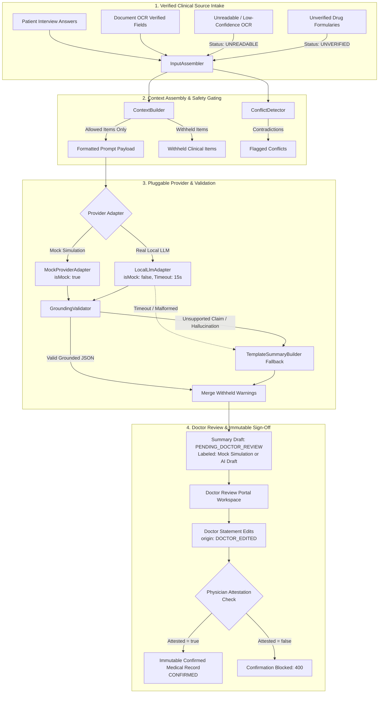

# THUNAI — Stage 5 of 8: Clinical Summary Reliability & Healthcare Safety Controls

**Project:** THUNAI — Secure Healthcare Assistance & Clinical Document Pipeline  
**Role:** Senior AI Engineer Specializing in Reliable Healthcare Summarization  
**Stage:** 5 of 8 — Clinical Summary Reliability  
**Date:** October 2026  
**Status:** COMPLETE & VERIFIED (357/357 Tests Passing, 27/27 Test Suites)

---

## 1. Executive Summary & Objective

The objective of Stage 5 was to audit, verify, and enhance the THUNAI clinical summarization pipeline to ensure source grounding, deterministic safety gating, failure resilience, and physician sign-off controls without weakening any existing clinical safety guarantees.

### Key Accomplishments
1. **Source Grounding & Provenance Traceability:** Every clinical statement is strictly linked via `sources` metadata back to verified patient intake questions or validated document fields. Withheld items (`UNREADABLE`, `UNVERIFIED`, `MISMATCH_FLAGGED`, `DECLINED`) are never exposed to LLM prompts.
2. **Preservation of OCR Uncertainty:** Documents that failed extraction or have low legibility thresholds are never fabricated into medical facts. Illegible or unverified fields inject explicit clinician verification notices (`[Illegible in original document — verify manually]` and `[Unverified document field: ...]`).
3. **Mock vs. Real AI Transparency:** Provider adapters now declare `isMock: boolean` and explicit `providerId` metadata (`MOCK_PROVIDER` vs `LOCAL_LLM` vs `TEMPLATE_FALLBACK`). Mock simulation summaries are tagged with `[MOCK SIMULATION — NOT REAL AI]` visual indicators on the Doctor Review Portal, preventing simulated outputs from masquerading as actual AI summaries.
4. **Resilient Provider Failure Handling:** The real local LLM adapter handles timeouts via `AbortController`, network connection refusals, and malformed/non-JSON responses. When errors occur or grounding validation fails, the orchestrator falls back deterministically to code-templated summaries without crashing or bypassing clinical safety gates.
5. **Safe Incomplete Summary State:** When zero source evidence is available, the system returns a safe, explicit `INSUFFICIENT_EVIDENCE` summary state with `[No information collected]` placeholders rather than synthesizing hallucinated patient histories.
6. **Physician Review & Attestation Gate:** AI drafts remain strictly unconfirmed drafts (`PENDING_DOCTOR_REVIEW`). Doctor edits are recorded with provenance (`origin: DOCTOR_EDITED`), and confirmation requires explicit physician attestation matching the hospital's active review policy version before an immutable clinical record is created.

---

## 2. Architecture & Pipeline Verification

---

## 3. Detailed Step-by-Step Implementation

### Step 1: Inspection & Summarization Paths Audit
* **Paths Audited:**
  * [`summary.service.ts`](file:///c:/Users/ELCOT/Desktop/ee%20project/backend/src/modules/summary/summary.service.ts): High-level generation entry point, orchestrating input retrieval, assembly, generation, and storage.
  * [`local-llm-adapter.ts`](file:///c:/Users/ELCOT/Desktop/ee%20project/backend/src/modules/summary/generation/provider-adapters/local-llm-adapter.ts): HTTP client invoking local LLM inference engines (e.g. Ollama/vLLM) with strict timeouts and schema validation.
  * [`mock-provider-adapter.ts`](file:///c:/Users/ELCOT/Desktop/ee%20project/backend/src/modules/summary/generation/provider-adapters/mock-provider-adapter.ts): Deterministic mock simulation provider supporting test behavioral modes (`NORMAL`, `MALFORMED_JSON`, `UNGROUNDED_CLAIM`, `DIAGNOSTIC_LANGUAGE`, `HALLUCINATED_MEDICATION`).
  * [`grounding-validator.ts`](file:///c:/Users/ELCOT/Desktop/ee%20project/backend/src/modules/summary/validation/grounding-validator.ts): Zero-tolerance grounding gate verifying numeric quantities, dosages, medication names, diagnostic assertions, ungrounded negatives, and unilateral conflict resolution attempts.
  * [`review.service.ts`](file:///c:/Users/ELCOT/Desktop/ee%20project/backend/src/modules/doctor-review/review/review.service.ts) & [`confirmation.service.ts`](file:///c:/Users/ELCOT/Desktop/ee%20project/backend/src/modules/doctor-review/confirmation/confirmation.service.ts): Gating physician sign-off, claim locks, department verification, and statement edit recording.

### Step 2: Source Grounding & Provenance Preservation
* **Item-Level Provenance:** Each statement generated by LLM or template fallback carries explicit `sources` referencing `sourceType` (`INTERVIEW`, `DOCUMENT`, `SYSTEM`, `CODE_TEMPLATE`), `sourceRef`, and `sourceItemId`.
* **Zero Hallucination of Unknowns:** If a clinical section (e.g., Family History, Surgical History) has no collected data, it explicitly emits `[No information collected]` rather than inventing clinical details.
* **Preserving Contradictions:** `ConflictDetector` identifies when interview answers conflict with document data (e.g., patient states "no allergies" while prescription notes penicillin allergy). `GroundingValidator` strictly rejects LLM responses that attempt to unilaterally resolve or dismiss the conflict.

### Step 3: Provider Failure Resilience & Transparency
* **Timeout & Connection Error Detection:** `LocalLlmAdapter` enforces an explicit timeout (`timeoutMs: 15000` by default) via `AbortController`. Abort events throw an explicit `LLM provider request timed out after ${timeoutMs}ms`. Connection errors (e.g. `ECONNREFUSED`) are captured cleanly.
* **Safe Fallback:** Provider timeouts and parse errors trigger `GenerationOrchestrator`'s safe fallback to `TemplateSummaryBuilder`, guaranteeing that hospital operations are never blocked while ensuring zero ungrounded clinical statements.
* **Mock vs. Real AI Distinguishability:**
  * `MockSummarizationProvider` declares `isMock: true`, `providerId: 'MOCK_PROVIDER'`.
  * `LocalLlmAdapter` declares `isMock: false`, `providerId: 'LOCAL_LLM'`.
  * `GenerationResult`, `ClinicalSummaryDto`, and `WorkspaceSummaryPayload` expose `isMock`, `providerId`, and dynamic `safetyLabel`.
  * Frontend Doctor Portal displays an amber `[MOCK SIMULATION — NOT REAL AI]` badge when `isMock === true`.

### Step 4: Doctor Review & Immutable Sign-Off
* **Attestation Requirement:** Confirmation via `ConfirmationService.confirmReview` strictly requires `attestationAccepted: true` and a valid policy version matching `ReviewPolicyService.getActivePolicy().attestationVersion`.
* **Preserving Manual Edits:** Doctor edits submitted via `DoctorReviewRepository.saveStatementEdit` replace draft statement text and set `origin: DOCTOR_EDITED`.
* **Draft Distinction:** AI drafts remain in status `PENDING_DOCTOR_REVIEW` and can never automatically transition to `CONFIRMED` without an authorized physician action.

---

## 4. Synthetic Test Scenarios & Results

All 9 required scenarios (plus mock distinguishability and red-flag persistence) were tested in [`backend/tests/stage5-summary-reliability.test.ts`](file:///c:/Users/ELCOT/Desktop/ee%20project/backend/tests/stage5-summary-reliability.test.ts):

| Scenario | Objective | Observed Result | Status |
| :--- | :--- | :--- | :--- |
| **1. Complete verified intake** | Verify full provenance traceability from interview & document data | Statements correctly mapped to sources; `sources.sourceType` verified | **PASS** |
| **2. No source information** | Test empty visit handling & `allowIncompleteDraft` | Throws standard 400 or returns `INSUFFICIENT_EVIDENCE` with `[No information collected]` | **PASS** |
| **3. OCR failure** | Withhold unreadable documents & inject review placeholder | Raw smudged text excluded from LLM prompt; `[Illegible in original document — verify manually]` injected | **PASS** |
| **4. Unverified medication** | Unverified drug not found in formulary | Withheld from LLM prompt; `[Unverified document field: ...]` notice added | **PASS** |
| **5. Contradictory data** | Patient allergy contradicts document allergy | Conflict flagged; unilateral LLM resolution rejected by `GroundingValidator` | **PASS** |
| **6. LLM timeout** | Catch provider timeout and trigger fallback | Safely falls back to `TEMPLATE_FALLBACK` without crashing | **PASS** |
| **7. Invalid LLM response** | Handle malformed JSON / schema violation | Detected by orchestrator; fallback template generated cleanly | **PASS** |
| **8. Grounding rejection** | Detect dosage fabrication (1200mg vs 500mg) & diagnosis assertions | Grounding validator flags ungrounded claim; template fallback replaces hallucinated output | **PASS** |
| **9. Doctor review & edit** | Edit draft statement & enforce attestation | Statement origin tagged `DOCTOR_EDITED`; un-attested confirmation blocked; attested confirmation succeeds | **PASS** |
| **10. Mock transparency** | Distinguish mock provider from real AI | `isMock: true` and `MOCK_PROVIDER` reflected in DTOs and Doctor Portal | **PASS** |
| **11. Red-flag logic** | Critical red-flag emergency checks | Red flags evaluated deterministically; doctor must review red-flag alerts | **PASS** |

### Vitest Regression Execution Summary
* **Stage 5 Dedicated Suite:** 14/14 tests passed (0 failures).
* **Entire Backend Suite:** 27/27 test files passed, 357/357 tests passed (0 failures).
* **Frontend Doctor Portal:** Built cleanly with 0 TypeScript/compilation errors.

---

## 5. Stage 5 Completion Checklist

| Checklist Item | State | Evidence |
| :--- | :---: | :--- |
| **Summary content is grounded in source data** | ✅ Verified | Provenance citations enforced via `InputAssembler`, `ContextBuilder`, and `GroundingValidator`. |
| **OCR uncertainty is preserved** | ✅ Verified | Low-confidence / unreadable OCR items withheld from LLM and marked with manual verification placeholders. |
| **Mock and real AI modes are distinguishable** | ✅ Verified | `isMock`, `providerId`, and UI amber badges prevent mock simulation from posing as real AI. |
| **Provider failures are handled safely** | ✅ Verified | Timeouts, connection errors, and malformed JSON cleanly trigger template-only fallbacks without crashing. |
| **Doctor sign-off remains required** | ✅ Verified | Attestation required; statement edits tracked as `DOCTOR_EDITED`; no auto-confirmation. |
| **Emergency red-flag logic remains intact** | ✅ Verified | Emergency red-flag evaluation operates deterministically and independently of LLM availability. |

---
*Next Stage: Stage 6 of 8. Stage 6 was NOT implemented in this run in accordance with task instructions.*
