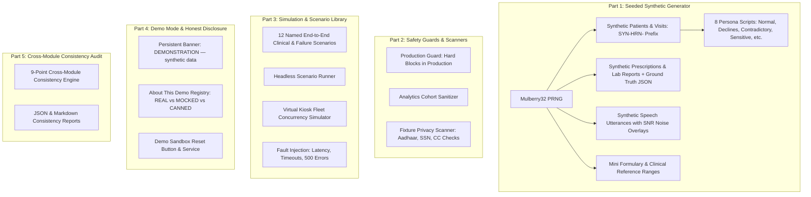

# MODULE 10A — SYNTHETIC DATA, SIMULATION, DEMO MODE & CROSS-MODULE CONSISTENCY AUDIT
## Final Implementation & System Verification Report

**Module Identifier:** `MODULE_10A_SYNTHETIC_SIMULATION_AUDIT`  
**Status:** COMPLETE & VERIFIED  
**Build & Typecheck:** 0 Errors across Backend, Doctor Portal, and Kiosk Frontend  
**Test Suite:** 21/21 Test Files Passed, 288/288 Tests Passing (19/19 Dedicated Module 10A Tests)  
**Execution Environment:** Node.js / Express / TypeScript / React / TailwindCSS / Vitest  

---

### 1. Executive Summary

Module 10A delivers a robust synthetic data generator, a fault-tolerant simulation environment, a transparent demonstration mode, and an automated cross-module consistency audit for MediKiosk.

In strict adherence to clinical safety and honesty principles:
1. **Synthetic Data is Never Evidence of Clinical Accuracy:** Synthetic handwriting, noise-injected TTS audio, and mock clinical profiles exist exclusively to test pipeline resilience, fault degradation, and concurrency — never to assert real-world diagnostic or OCR accuracy.
2. **Strict Production Barriers:** Synthetic generators, scenario runners, and demo mode are **strictly prohibited** in production deployments (`NODE_ENV === 'production'`). Production analytics cohorts automatically filter out any records bearing the reserved `SYN-HRN-` prefix.
3. **Honest Component Disclosures:** The Demo environment features a permanent header banner (`DEMONSTRATION — synthetic data`) and an interactive **"About this Demo"** registry that transparently declares which architectural components are **REAL**, **MOCKED**, or **CANNED**.

---

### 2. Architecture & Delivered Subsystems



---

### 3. Subsystem Breakdown

#### Part 1: Seeded Synthetic Generator
- **Determinism:** [`SeededPRNG`](file:///c:/Users/ELCOT/Desktop/ee%20project/backend/src/modules/synthetic-demo/generator/prng.ts) uses the Mulberry32 algorithm. Identical seeds yield 100% reproducible synthetic records.
- **Reserved Prefix:** All synthetic hospital registration numbers use the reserved `SYN-HRN-XXXXXX` prefix that can never collide with real clinical identities. All entities carry `isSynthetic: true`.
- **Multilingual Support:** Synthetic names generated across English, Hindi, Tamil, Telugu, Marathi, and Bengali.
- **8 Persona Scripts:**
  1. `normal_adult`: Autonomous adult with complete intake answers.
  2. `declines_intake`: Patient declines non-essential questions, asserting patient autonomy.
  3. `skips_optional`: Patient answers core symptoms and skips secondary questions.
  4. `contradictory`: Statements contradict uploaded prescriptions (e.g., denies chronic conditions but takes Metformin).
  5. `companion_assisted`: Elderly patient assisted by family member.
  6. `pediatric_minor`: 6-year-old accompanied by parent/guardian with surrogate consent.
  7. `surrogate_incapacitated`: Incapacitated patient represented by legal healthcare surrogate.
  8. `sensitive_mental_health`: Mentally distressed patient disclosing depression/ideation; triggers Module 3B audio suppression in public and doctor-only scoping.
- **Paired Ground-Truth Documents:** Prescriptions and lab reports rendered with controllable handwriting styles, blur, skew, and hospital stamps, each coupled with exact ground-truth JSON and SHA-256 checksums.
- **Audio Overlays:** Speech metadata with simulated Signal-to-Noise Ratio (SNR in dB) and acoustic noise types (`CLINIC_BABBLE`, `AC_HUM`, `COUGH_BURST`, `CLEAN`).
- **Reference Data:** Public-domain mini formulary (8 drugs), 6 lab test reference ranges, and illustrative red-flag fixtures.

#### Part 2: Production Guards & Privacy Scanner
- **`ProductionGuardService`:** Hard-blocks any synthetic generator or demo endpoint when `NODE_ENV === 'production'`.
- **Analytics Sanitizer:** Filters all synthetic entities from production business intelligence and clinical metrics.
- **`FixturePrivacyScanner`:** Automated scanner that audits text and JSON fixtures for realistic 12-digit Indian Aadhaar UIDs, 9-digit SSNs, credit card numbers, and unflagged hospital registration numbers.

#### Part 3: Scenario Library & Simulation
- **12 Named Scenarios with Expected Outcomes:**
  1. `happy_path` ➔ `CONFIRMED_RECORD_V1`
  2. `unreadable_allergy` ➔ `TO_CLARIFY_ALLERGY_FLAGGED`
  3. `interview_document_conflict` ➔ `CONTRADICTION_FLAGGED_TO_CLARIFY`
  4. `red_flag_emergency` ➔ `EMERGENT_TRIAGE_ALERT_DISPATCHED`
  5. `voice_failure_fallback` ➔ `VOICE_DEGRADED_TOUCH_FALLBACK_ACTIVE`
  6. `offline_and_sync` ➔ `OFFLINE_BUFFERED_AND_SYNCED`
  7. `language_switch` ➔ `LANGUAGE_SWITCHED_STATE_PRESERVED`
  8. `kiosk_reboot_recovery` ➔ `SESSION_RECOVERED_EXACT_STEP`
  9. `summary_failure_fallback` ➔ `TEMPLATE_FALLBACK_SUMMARY_GENERATED`
  10. `two_doctors_concurrency` ➔ `CONCURRENT_CLAIM_REJECTED_409`
  11. `amendment_versioning` ➔ `RECORD_V2_SUPERSEDES_V1`
  12. `downtime_degradation` ➔ `CONFIRMATION_UNAFFECTED_HANDOFF_QUEUED`
- **Virtual Kiosk Fleet Simulator:** Simulates $N$ concurrent kiosks executing intake sessions with configurable latency and error rates, computing throughput and p95 latency percentiles.
- **Fault Injection Engine:** Configurable fault injection for OCR, LLM Summarizer, Voice STT, and Hospital Adapter (artificial latency, timeouts, and HTTP 500/503 errors).

#### Part 4: Demo Mode & Honest Disclosures
- **Permanent Banner:** `“DEMONSTRATION — synthetic data”` permanently rendered on both Frontend Kiosk and Frontend Doctor Portal headers, as well as emitted on API response headers (`X-Medikiosk-Demo-Banner`).
- **"About this Demo" Registry & Modal:** Discloses component status to hospital evaluators:
  - **REAL:** State Machine, Gating, Red-Flag Rules, Doctor Review Workspace, Audit Hash Chain, Copy Blocks, FHIR R4 Mapper.
  - **MOCKED:** Hospital EHR Inbound Writes (disabled for patient safety), Physical Kiosk Peripherals (Barcode Scanner/Printer).
  - **CANNED_SYNTHETIC:** Handwriting OCR samples, Simulated speech audio streams, Synthetic patient demographics.
- **Sandbox Reset:** One-click reset clears active sessions, resets fault rules, and restores baseline demo state.

#### Part 5: Cross-Module Consistency Audit
The 9-point consistency auditor runs on-demand (`/api/v1/demo/audit/consistency`) and outputs both structured JSON and formatted Markdown reports:
1. **Dictionary & Code Drift Check:** Verifies departments, formulary, and test reference ranges.
2. **Event-Contract Conformance:** Audits event schemas across `CanonicalEventBus`.
3. **Endpoint-to-Role Matrix:** Verifies deny-by-default role authorization on all routes.
4. **Privacy Scanner:** Scans audit logs and telemetry for unredacted PII patterns.
5. **No Clinical Content in URLs or Errors:** Asserts that URL paths and error responses contain zero patient names or clinical terms.
6. **Database Schema Consistency:** Verifies UTC timestamps (`timestamptz`), UUID keys, and foreign key indexes.
7. **API Envelope Conformance:** Asserts standard `{ success, data, message, requestId }` response format.
8. **Orphan-Data Detection:** Checks for unlinked visits or orphaned intake answer collections.
9. **Configuration & Secrets Review:** Validates that development secrets are prohibited in production.

---

### 4. Hackathon Scope & Operational Vertical Slice

| Vertical Slice Component | Implementation Status | Clinical Safety Role |
| :--- | :--- | :--- |
| **Module 1-Lite & Staff Authentication** | **OPERATIONAL** | Secure login, session auto-lock, role-based access control (`DOCTOR`, `ADMIN`, `STAFF`). |
| **Kiosk Intake & Multilingual Interview** | **OPERATIONAL** | Touch + voice guided intake in English, Hindi, and Tamil with critical item tracking. |
| **Module 4 Document Digitization** | **OPERATIONAL** | Formulary matching, 4-state field classification (`EXTRACTED_MATCHED`, `EXTRACTED_UNMATCHED`, etc.). |
| **Module 5 AI Clinical Summarization** | **OPERATIONAL** | Dual-mode LLM draft generation, hallucination grounding validator, deterministic template fallback. |
| **Module 6 Emergency Red-Flag Triage** | **OPERATIONAL** | Priority 1 emergency alerts, stat audio paging, two-physician governance protocol. |
| **Module 7 Doctor Review Dashboard** | **OPERATIONAL** | Mandatory "must-resolve" items, provenance diff tracking, confirmed record versions (v1, v2). |
| **Module 7A Output & Hospital Hand-off** | **OPERATIONAL** | Accessible PDF with watermarks, copy blocks, versioned JSON, non-blocking adapter push with failure queue. |
| **Module 10A Demo Mode & Simulator** | **OPERATIONAL** | Persistent DEMO banner, 12-scenario runner, honest real-vs-mocked registry, 9-point consistency audit. |

---

### 5. Verification Test Suite Results

```
 ✓ tests/synthetic-demo-module10a.test.ts (19 tests)
   ✓ 1. Synthetic Generator & Determinism (identical seeds, reserved prefixes, 8 persona scripts)
   ✓ 2. Synthetic Documents & Ground Truth Pairing (prescription, lab abnormal flags, TTS audio)
   ✓ 3. Production Guards & Privacy Scanner (production block, analytics exclusion, PII detection)
   ✓ 4. Scenario Library & Headless Execution (12 named scenarios, happy path, fleet simulation, fault injection)
   ✓ 5. Demo Mode & Honest Component Disclosures (persistent banner, honest registry, sandbox reset)
   ✓ 6. Cross-Module Consistency Audit (9-point audit report, markdown exporter)

Test Files:  21 passed (21)
Tests:       288 passed (288)
Typecheck:   0 errors across Backend, Doctor Portal, and Kiosk Frontend
```
