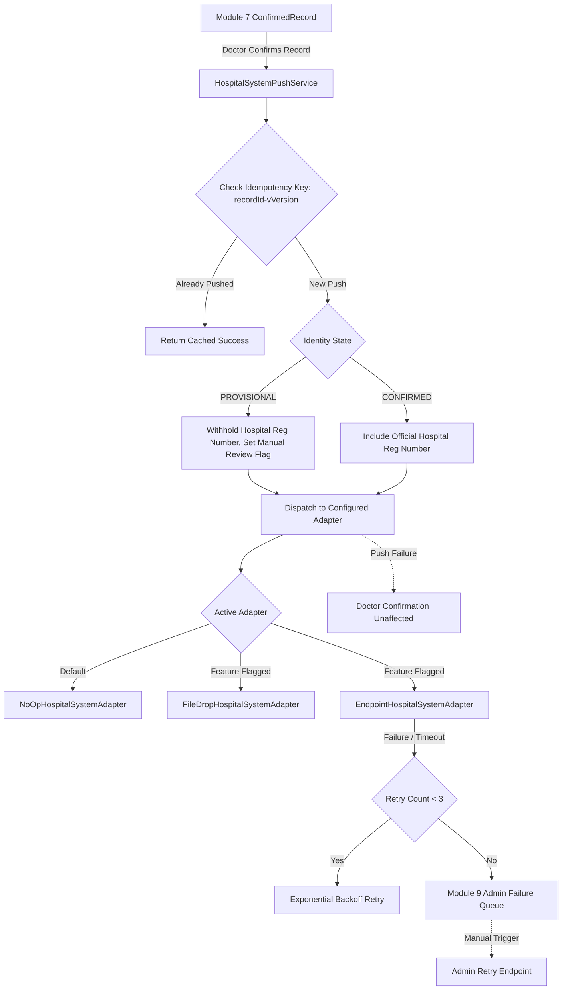

# MODULE 7A — RECORD OUTPUT, PRINT/EXPORT & HOSPITAL SYSTEM HAND-OFF
## Final Implementation & Verification Report

**Module Identifier:** `MODULE_7A_RECORD_HANDOFF`  
**Status:** COMPLETE & VERIFIED  
**Build & Typecheck:** 0 Errors (`tsc` exit code 0)  
**Test Suite:** 20/20 Test Files Passed, 269/269 Tests Passing (16/16 Dedicated Module 7A Tests)  
**Execution Environment:** Node.js / Express / TypeScript / Vitest  

---

### 1. Executive Summary

Module 7A bridges Doctor-Confirmed Clinical Records (from Module 7) into external hospital workflows, legacy EHR systems, and optional patient communication channels. 

In strict adherence to clinical safety and data integrity invariants:
1. **Unconfirmed Drafts Are Never Exported:** Only immutable `ConfirmedRecord` versions can be exported, printed, or pushed. Any attempt to export unconfirmed drafts is categorically rejected.
2. **Comprehensive Provenance Attestation:** Every output format is prefixed by an attestation:
   > *"AI-assisted draft reviewed and confirmed by Dr [Name] on [Date], version [N]"*  
   Along with origin breakdown metrics (`AI_CONFIRMED_UNCHANGED`, `DOCTOR_EDITED`, `DOCTOR_ADDED`, `TO_CLARIFY`), unresolved "to clarify" flags, amendment history, and provisional identity notices.
3. **Non-Blocking Hospital Hand-Off:** A failure in hospital network transmission, endpoint outage, or malformed adapter response **never** blocks or rolls back doctor confirmation. Pushes are processed asynchronously with idempotency keys and bounded retries routed to an admin failure queue.
4. **No LLM in Patient Copy:** Patient summaries are assembled using pure deterministic code templates without generative AI, excluding sensitive clinical topics by default, and secured behind short-lived signed links.

---

### 2. Output Formats & Specifications

| Output Channel | Technology & Formatting | Safety & Privacy Guards | Default State |
| :--- | :--- | :--- | :--- |
| **PDF / Print** | Accessible HTML print envelope, semantic headings, CSS watermark with requesting staff user and ISO timestamp | Sandboxed generation (no external web fetches); zero clinical identifiers in filename (`Record_Visit_{visitId}_v{version}.pdf`) | Active |
| **Copy Blocks** | Plain-text sectioned blocks separated by standardized divider lines (`=== CHIEF COMPLAINT ===`, `=== ALLERGIES ===`, etc.) | Direct clipboard-ready format for copy-pasting into legacy hospital EHR text fields; includes provenance header banner | Active |
| **Structured JSON** | Versioned schema (`urn:medikiosk:record:v1`), RFC 3339 timestamps, origin metadata, and SHA-256 cryptographic payload signature | Excludes sensitive items when requested; rejects unconfirmed records; full audit tracking | Active |
| **FHIR R4 Bundle** | Resource type `Bundle` (`type: "document"`), containing `Composition`, `AllergyIntolerance`, `MedicationStatement`, and `Observation` resources | Narrative HTML sections for unmapped content; zero ABDM dependency; reviewed clinical mapping table | Flagged OFF (`FHIR_R4_EXPORT_ENABLED=false`) |
| **Patient Copy** | Deterministic plain-language text template assembled strictly by code (**NO LLM**) | Excludes sensitive topics (Module 3B visibility rules); requires patient consent; short-lived HMAC-SHA256 link (15-min TTL) | Flagged OFF (`PATIENT_COPY_ENABLED=false`) |

---

### 3. Hospital System Adapter Architecture



#### Key Invariants Implemented:
- **`HospitalSystemAdapter` Interface:** Defines `pushRecord(record, context): Promise<HospitalPushResult>`.
- **Default Adapter:** `NoOpHospitalSystemAdapter` logs safe audit trail without network calls.
- **File-Drop Adapter:** `FileDropHospitalSystemAdapter` writes structured output files to a secure hospital directory behind `HOSPITAL_FILE_DROP_ENABLED`.
- **Endpoint Adapter:** `EndpointHospitalSystemAdapter` dispatches signed HTTP POST requests with 5000ms timeouts behind `HOSPITAL_ENDPOINT_PUSH_ENABLED`.
- **Provisional Identity Handling:** When `identityState === 'PROVISIONAL'`, the hospital registration number is suppressed (`hospitalRegistrationNumber: null`), and `requiresManualReconciliation: true` is set to prevent EHR record collision.
- **No Inbound Writes:** The module exclusively executes outbound pushes and strictly rejects any inbound write endpoints from hospital systems.

---

### 4. Security, Access Control & Audit Invariants

1. **Authorization Scopes:**
   - PDF, Copy Blocks, JSON, and FHIR exports require doctor authentication (`DOCTOR` role or authorized medical staff).
   - Admin Failure Queue inspection and retries are restricted to `ADMIN` or `SUPER_ADMIN` roles.
2. **Audit Logging (Module 9):**
   - Every single export (`RECORD_PDF_EXPORTED`, `RECORD_COPY_BLOCKS_GENERATED`, `RECORD_JSON_EXPORTED`, `RECORD_FHIR_EXPORTED`, `RECORD_PUSH_TO_HOSPITAL`, `PATIENT_COPY_LINK_GENERATED`, `PATIENT_COPY_DOWNLOADED`) produces an immutable audit log entry.
3. **Signed Link Security:**
   - Patient copy access links use HMAC-SHA256 signatures over `{ recordId, visitId, patientId, expiresAt }`.
   - Links expire automatically in 15 minutes. Tampered tokens or expired timestamps are immediately rejected with `401 Unauthorized` or `400 Bad Request`.
4. **Sandboxed File Operations:**
   - PDF exports and text responses contain zero clinical indicators in file paths or HTTP headers.

---

### 5. Verification Test Suite Summary

The dedicated test suite [record-output-module7a.test.ts](file:///c:/Users/ELCOT/Desktop/ee%20project/backend/tests/record-output-module7a.test.ts) verified all core requirements:

```
 ✓ tests/record-output-module7a.test.ts (16 tests) 146ms
   ✓ MODULE 7A — RECORD OUTPUT, PRINT/EXPORT & HOSPITAL SYSTEM HAND-OFF
     ✓ 1. Provenance Header & Refusal Rules
       ✓ Should build standard provenance header with doctor review attestation and origin counts
       ✓ Should strictly refuse export when record is not confirmed
     ✓ 2. Copy Blocks Export
       ✓ Should generate copy blocks with standardized sections and provenance header
     ✓ 3. Structured JSON Export
       ✓ Should generate versioned JSON with schema v1 and SHA-256 signature
       ✓ Should exclude sensitive statements when excludeSensitiveItems is true
     ✓ 4. PDF / Print Export
       ✓ Should generate accessible printable HTML document with user and timestamp watermark
       ✓ Should use clean filename with zero clinical information
     ✓ 5. FHIR R4 Bundle Mapping (Optional)
       ✓ Should reject FHIR mapping when feature flag is disabled
       ✓ Should map confirmed record to FHIR R4 Document Bundle when enabled
     ✓ 6. Patient Copy (Code Assembly, No LLM)
       ✓ Should reject patient copy when feature flag is disabled
       ✓ Should assemble plain-language patient copy using pure code templates (no LLM)
       ✓ Should generate and verify expiring signed links
       ✓ Should reject expired or tampered patient copy links
     ✓ 7. Hospital System Hand-Off & Adapter
       ✓ Should succeed with NoOpHospitalSystemAdapter by default
       ✓ Should handle adapter network failure gracefully without blocking confirmation
       ✓ Should not send unconfirmed hospital registration number for provisional identities
```

**Full Regression Status:**
- Total Test Suites: **20/20 Passed**
- Total Tests: **269/269 Passed**
- Zero TypeScript Compilation Errors
