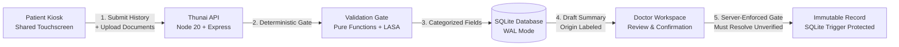

# Thunai (துணை) — Architecture & Safety Specification

> **Tagline:** *"The companion before the doctor."*  
> **Status:** Hackathon Demo Slice (Tasks D0–D7)  
> **Core Principle:** AI and OCR never decide clinical truth; the deterministic validation gate decides trust; the physician is the final authority.

---

## 1. System Topology & Workflow

### High-Level Workflow
1. **Patient Intake:** Patient answers structured history interview (8 questions storing standardized codes, never translated text) and presents prescription paper.
2. **Deterministic Processing:** Code normalizes text, executes Levenshtein fuzzy matching against formulary, checks LASA safety margin, and flags any ambiguous abbreviation or low confidence.
3. **Uncertain Value Isolation:** Uncertain text is **never** fed to any LLM. Placeholders (e.g., *"Illegible in original document - verify manually"*) are injected by pure code with origin `AUTO-INSERTED`.
4. **Physician Confirmation Gate:** The server inspects the visit. If any critical item is `UNVERIFIED`, `UNREADABLE`, `MISMATCH_FLAGGED`, or an active alert remains unacknowledged, confirmation is **rejected with HTTP 409 Conflict**.
5. **Immutable Record Creation:** Once confirmed, the record is written to `confirmed_records` where SQLite triggers permanently prohibit updates and deletions.

---

## 2. Deterministic Validation Gate Thresholds

The thresholds are centralized in `apps/api/src/config/validation-gate.config.ts`:

| Threshold Constant | Placeholder Value | Purpose |
| :--- | :---: | :--- |
| `OCR_MIN_USABLE` | `0.30` | Below this, OCR text is declared `UNREADABLE`. |
| `OCR_MIN_VERIFIED` | `0.70` | Below this, OCR text cannot be `VERIFIED`. |
| `MATCH_VERIFIED` | `0.85` | Minimum Levenshtein score against formulary to verify. |
| `MATCH_FLOOR` | `0.60` | Minimum score to consider candidate; below is `MISMATCH_FLAGGED`. |
| `LASA_MARGIN` | `0.10` | If runner-up (or LASA pair) is within 10%, marked `UNVERIFIED`. |

> *Note:* Values are placeholders to be calibrated against empirical hospital training data during clinical trials.

---

## 3. UI Design System Tokens (Prompt U1)

Thunai employs a dignified **White, Cream, and Red** palette tailored for Tamil Nadu government hospital environments. Dark mode is strictly disabled.

| Token Group | Values | Usage |
| :--- | :--- | :--- |
| **White & Cream** | `#ffffff`, `#faf7f2`, `#fdfbf7`, `#f0e9dc` | Clean hospital paper surfaces, cards, and warm background. |
| **Hospital Red** | `#b91c1c` (Primary), `#991b1b` (Hover), `#7f1d1d` (Deep) | Header accent, primary buttons, emergency red-flag badges. |
| **Text Contrast** | `#1c1917` (Primary), `#44403c` (Body), `#78716c` (Muted) | High legibility on shared kiosk displays. |
| **Field States** | `VERIFIED` (Green), `UNVERIFIED` (Amber), `UNREADABLE` (Red), `MISMATCH_FLAGGED` (Crimson) | Origin-linked status badges. |

---

## 4. Built vs. Mocked Engineering Boundaries

| Category | Built in Demo Slice | Mocked / Roadmap Only |
| :--- | :--- | :--- |
| **Intake** | 8 structured questions, bilingual labels, "prefer not to answer" | Voice/Audio intake, regional dialects |
| **Validation** | Pure function Levenshtein matcher, LASA runner-up evaluator | Custom deep-learning OCR handwriting models |
| **Doctor Portal**| Must-resolve interactive resolution, HTTP 409 enforcement | Hospital HIS/EMR bidirectional synchronization |
| **Data Safety** | Immutable records with SQLite triggers, zero PHI in logs | Regulatory SaMD / CDSCO medical device filings |
