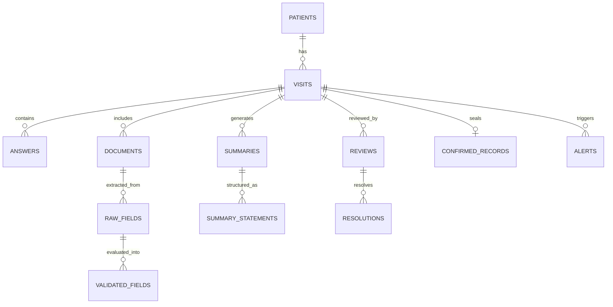

# Thunai SQLite Data Model

> **Database:** SQLite in WAL mode with Foreign Key and Trigger Enforcements.  
> **Schema Location:** `apps/api/src/db/schema.sql`

---

## 1. Relational Entity Overview



---

## 2. Table Specifications

### `patients`
- `id` (TEXT, PK): Unique patient identifier (`pat-demo-001`).
- `mrn` (TEXT, UNIQUE): Hospital Medical Record Number (`TN-GH-2026-001`).
- `name` (TEXT): Full name.
- `age` (INTEGER): Age in years.
- `gender` (TEXT): `M`, `F`, `O`.
- `phone` (TEXT): Contact number.
- `created_at` (TEXT): Timestamp.

### `visits`
- `id` (TEXT, PK): Visit identifier (`vis-demo-001`).
- `patient_id` (TEXT, FK): References `patients(id)`.
- `status` (TEXT): `CREATED`, `INTAKE_IN_PROGRESS`, `INTAKE_COMPLETE`, `READY_FOR_REVIEW`, `CONFIRMED`.
- `token_number` (TEXT): Queue slip token (`OPD-01`).
- `created_at`, `updated_at` (TEXT).

### `answers`
- `id` (TEXT, PK): `ans-demo-001`.
- `visit_id` (TEXT, FK): References `visits(id)`.
- `question_code` (TEXT): `Q_REASON`, `Q_DURATION`, `Q_CHEST_PAIN`, `Q_BREATHING`, `Q_ON_MEDS`, `Q_ALLERGY`, `Q_CONDITIONS`, `Q_FAMILY`.
- `option_code` (TEXT): Selected standardized code.
- `value_text` (TEXT): Verbatim free text if applicable.
- `state` (TEXT): `ANSWERED`, `SKIPPED`, `DECLINED` ("Prefer not to answer").
- `is_critical` (INTEGER): 1 if safety-critical, 0 otherwise.

### `documents`
- `id` (TEXT, PK): Document identifier (`doc-demo-001`).
- `visit_id` (TEXT, FK): References `visits(id)`.
- `file_path` (TEXT): Relative path to scanned SVG/PNG.
- `doc_type` (TEXT): `PRESCRIPTION`, `LAB_REPORT`.
- `mime_type` (TEXT): e.g. `image/svg+xml`.
- `status` (TEXT): `PENDING_OCR`, `OCR_PROCESSED`, `FAILED`.

### `raw_fields`
- `id` (TEXT, PK): Raw field reference (`raw-001-1`).
- `document_id` (TEXT, FK): References `documents(id)`.
- `field_type` (TEXT): `drug_name`, `dosage`, `allergy`, `instruction`.
- `raw_text` (TEXT): Verbatim OCR string.
- `ocr_confidence` (REAL): Float between 0.00 and 1.00.
- `bbox_json` (TEXT): JSON coordinates `{ x, y, width, height }`.

### `validated_fields`
- `id` (TEXT, PK): Validated result reference (`val-001-1`).
- `raw_field_id` (TEXT, FK): References `raw_fields(id)`.
- `field_type` (TEXT): Drug, allergy, etc.
- `is_critical` (INTEGER): 1 if safety-critical.
- `result` (TEXT): `VERIFIED`, `UNVERIFIED`, `UNREADABLE`, `MISMATCH_FLAGGED`.
- `matched_value` (TEXT): Standardized generic name or formulary term.
- `match_score` (REAL): Fuzzy match score (0.00 to 1.00).
- `reason_code` (TEXT): e.g., `LOW_OCR_CONFIDENCE`, `AMBIGUOUS_ABBREVIATION`, `NO_FORMULARY_MATCH`.
- `formulary_version` (TEXT): `v1.0-demo`.

### `summaries` & `summary_statements`
- Sections: `CHIEF_COMPLAINT`, `HISTORY`, `MEDICATIONS`, `ALLERGIES`, `PAST_HISTORY`, `FAMILY_HISTORY`.
- Origin labels: `AUTO-INSERTED`, `AI-PHRASED`, `PATIENT QUOTE`, `DOCTOR-EDITED`.
- `source_refs_json`: Clickable links to document raw fields and interview answer IDs.
- `flags_json`: Array of flags, e.g. `['MUST_RESOLVE']`.

### `confirmed_records` [IMMUTABLE]
- `id` (TEXT, PK).
- `visit_id` (TEXT, UNIQUE, FK): One confirmed record per visit.
- `version` (INTEGER).
- `doctor_id` (TEXT).
- `confirmed_at` (TEXT).
- `content_json` (TEXT): Immutable snapshot of confirmed clinical intake.
- **Safety Trigger:**
  ```sql
  CREATE TRIGGER prevent_confirmed_record_update
  BEFORE UPDATE ON confirmed_records
  BEGIN
    SELECT RAISE(ABORT, 'IMMUTABLE_RECORD: Confirmed medical intake records cannot be modified.');
  END;
  ```

### `formulary`
- `id` (TEXT, PK).
- `generic` (TEXT, UNIQUE): Generic drug name.
- `brands_json` (TEXT): Array of commercial brand names.
- `lasa_partners_json` (TEXT): Array of Look-Alike Sound-Alike partner drugs.
- **Label:** `Demo dataset - not a clinical reference`.
